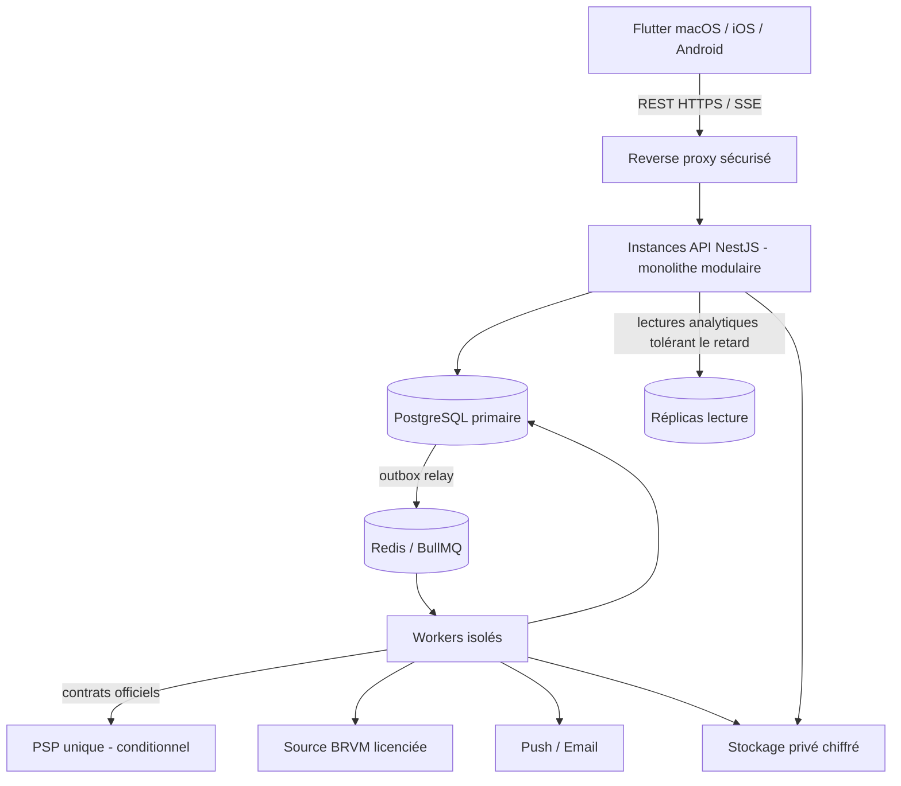
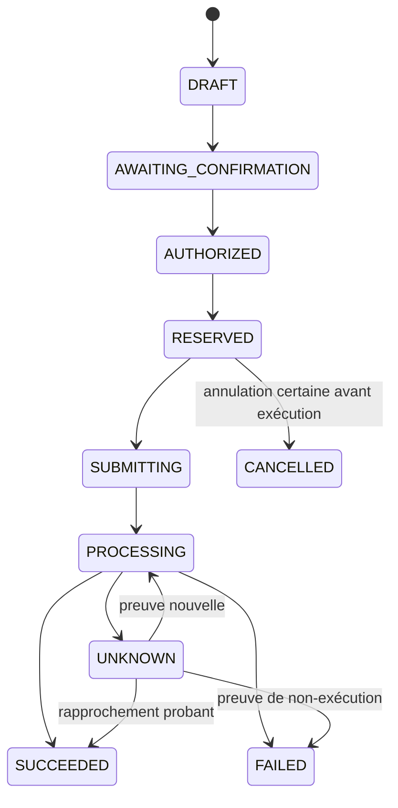
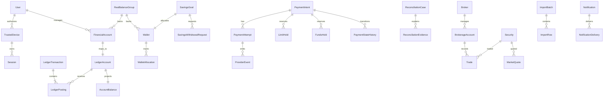

# BACKEND.MD — Spécification de conception du backend financier personnel

> **Version de référence :** 1.0 — 14 novembre 2026  
> **Statut :** spécification d'architecture issue de **B01–B42**, **D01–D75**, **UX01–UX24** et `llm.md` ; les intégrations externes non vérifiées restent conditionnelles.  
> **Produit :** application financière privée, **mono-utilisateur**, clientes Flutter macOS/iOS/Android.  
> **Backend retenu :** NestJS / TypeScript / PostgreSQL / Prisma ; monolithe modulaire et workers Redis/BullMQ ; API REST `/api/v1` et SSE.  
> **Devise de référence :** XOF (FCFA) ; dates stockées en UTC, présentation dans `Africa/Porto-Novo`.  
> **Nature :** document de conception **sans code applicatif**. Les modèles, routes et contrats ci-dessous spécifient l'implémentation à réaliser.

## 0. Mode d'emploi, règles de priorité et état des décisions

Ce document est destiné à une équipe d'ingénierie ou à un agent de développement. Il constitue la **référence backend**, à lire conjointement avec `llm.md` pour le périmètre métier et les parcours client. Le backend n'a pas à connaître la direction artistique « Calm Wealth — Expressive Edition », sauf lorsqu'elle implique des états et champs requis par les vues.

**Règles de priorité :** conformité légale et contractuelle > sécurité et intégrité des fonds > décisions métier D01–D75 > décisions backend B01–B42 > décisions UX UX01–UX24 > conventions de conception documentées. Toute modification d'une règle validée requiert un changement explicite. Les recommandations d'implémentation détaillées ci-dessous sont un **design proposé conforme aux choix validés**, pas de nouvelles validations métier implicites.

**Statuts :** `VALIDÉ` pour décisions confirmées ; `CONVENTION` pour détail technique à implémenter sans modification métier ; `CONDITIONNEL` si soumis au contrat/à l'API d'un tiers ; `RISQUE` pour incohérence ou hypothèse non résolue. Les points conditionnels sont **désactivés par défaut** tant que la preuve n'est pas disponible.

**Invariants absolus :**
1. Aucune écriture comptable confirmée ne peut être modifiée ou supprimée ; toute correction est compensatoire et traçable.
2. Les postings d'une transaction comptable doivent équilibrer ses débits et crédits **par devise** ; aucune entrée financière n'est artificiellement créée par une réaffectation.
3. Aucun paiement réel n'est considéré comme réussi sur une simple absence d'erreur réseau ; un résultat inconnu reste inconnu jusqu'à preuve concluante.
4. Aucun retry automatique d'une commande de transfert potentiellement exécutée ; des *lectures de statut* peuvent être réessayées.
5. Les plafonds, réservations, délégations exceptionnelles et restrictions sont évalués par le **serveur**, sous contrôle concurrent.
6. Une session ne remplace pas une approbation forte liée aux paramètres **exacts** de chaque payout.
7. L'épargne n'est dite « verrouillée » que si le chemin de sortie des fonds est effectivement contrôlé ; sinon les restrictions sont affichées comme **indicatives**.
8. Le client hors ligne ne peut pas initier de mouvements de fonds ni valider des actions sensibles ; chaque brouillon hors ligne est confirmé individuellement avant synchronisation.
9. Les comptes SGI, les actifs matériels et les enveloppes virtuelles sont distincts de l'argent effectivement encaissable ; aucune double valorisation patrimoniale.
10. Les réplicas de lecture ne participent jamais aux décisions financières nécessitant une cohérence forte.

---

# PARTIE A — FONDAMENTAUX

## 1. Produit, utilisateurs et périmètre

Une seule personne propriétaire du compte, utilisant plusieurs appareils de confiance (Mac, iPhone, Android). Le produit sert à gérer comptes et mouvements suivis, flux Mobile Money autorisés, coffres d'épargne, revenus/dépenses, budgets par cycles de revenus, dettes/créances, patrimoine et investissements BRVM **sans transmettre d'ordres de bourse**. Les actions serveur automatisées assistent, calculent, surveillent et notifient ; elles n'exécutent pas de nouveaux paiements sans consentement explicite.

Les seuls autres acteurs techniques sont : client/appareil, processus API, worker, fournisseur de paiement (PSP), fournisseur de données BRVM, service push/email, service de stockage, administrateur d'exploitation technique. Ce dernier ne devient **pas** un second utilisateur financier et ne doit pas pouvoir initier une opération au nom du propriétaire.

### 1.1 Périmètre V1 livré sans paiements réels

Actif : identité, sessions/appareils, registre et comptes suivis, revenus/dépenses externes, budgets, coffres en mode indicatif, dettes, patrimoine, compte espèces SGI, portefeuille BRVM, recherches, analyses, imports, SSE, notifications, sauvegardes et audit. Module PSP unique **intégré techniquement**, testable en sandbox, mais `real_payments_enabled=false` jusqu'à autorisations légales, contractuelles et tests de bout en bout concluants. La V1 n'est pas qualifiée de « paiement réel prêt » par sa seule existence technique.

Hors périmètre : comptes publics multi-tenant, co-approbation à deux, dépôt bancaire garanti, sous-comptes PSP supposés, trading d'actions intégré, débit automatique d'une contribution, tiers autorisés à utiliser l'application, fonction bancaire réglementée non autorisée.

## 2. Stack et architecture retenues — registre des choix

| Décisions | Choix **VALIDÉ** | Conséquence |
|---|---|---|
| B01–B02 | NestJS, TypeScript, PostgreSQL, Prisma, monolithe modulaire et workers | Modules cohérents, DB transactionnelle commune, workers isolés |
| B03, B32, B42 | Un PSP V1 derrière adaptateur, activation réelle séparée | Feature flag sécurisé, aucun appel réel non autorisé |
| B04–B06, B16–B24 | Double entrée, projections atomiques, fonds/allocations séparés, outbox | Cohérence forte, historique immuable et replay idempotent |
| B07–B12 | Machine d'états, rapprochement, limites, preuves fortes | Contrôle complet des sorties |
| B13–B15 | Appareils à clés, récupération, secrets/chiffrement | Sessions révocables et suspension de 48 h |
| B25–B27 | Stockage privé, rétention, synchronisation confirmée | Données sensibles et hors ligne contrôlés |
| B28–B30 | REST v1, OpenAPI, SSE, Redis/BullMQ | Contrats synchrones et traitements résilients |
| B31–B36 | Push+email pour chaque événement notifiable, BRVM, imports, rapprochement | Intégrations auditables |
| B37–B39 | Sécurité API renforcée, architecture distribuée + réplicas, Compose VPS | Besoin d'exploitation multi-hôte et protection des lectures critiques |
| B40–B42 | Sauvegardes externes + PITR, tests multicouches, V1 hors PSP | Activation des paiements comme jalon séparé |

### 2.1 Architecture logique



### 2.2 Topologie distribuée et contrainte Docker Compose

B38 exige des **réplicas PostgreSQL dès la V1**. B39 exige le déploiement **Docker Compose sur VPS**. **CONVENTION :** plusieurs nœuds VPS privés reliés par réseau chiffré ; ensembles Compose opérés séparément si nécessaire, sans prétendre qu'un `docker compose up` sur une seule machine produit de la HA. Un nœud primaire porte les écritures PostgreSQL ; des nœuds distincts peuvent héberger API/workers et réplicas de lecture. Toutes les commandes d'argent et vérifications d'autorisation utilisent le primaire. Une panne du primaire arrête les mutations sensibles jusqu'à une reprise **vérifiée** ; pas de basculement automatique dangereux avec risque de split-brain.

**RISQUE :** le nombre de nœuds, la localisation, le budget, la réplication synchrone ou asynchrone, le basculement et les garanties de disponibilité ne sont pas chiffrés. La V1 doit satisfaire B38 même sans prétendre une disponibilité 24/7 garantie. Mesurer le lag des réplicas, refuser les lectures analytiques obsolètes non signalées ; rediriger les lectures critiques vers le primaire.

## 3. Principes de conception

- Modules métier séparés à interfaces internes explicites ; accès aux écritures du registre uniquement via services de journal validés.
- Aucun controller n'écrit directement des soldes ; aucun worker n'appelle un PSP sans garde d'état et clés d'idempotence persistées.
- Transactions PostgreSQL courtes. Interdiction d'inclure un appel réseau externe dans une transaction PostgreSQL ouverte.
- Le commit du registre, de la projection de solde et de l'outbox est atomique.
- Tous les identifiants publics sont opaques (UUID/ULID), jamais une séquence exposée. `createdAt`, `updatedAt` en UTC lorsque pertinents, `version` pour concurrence optimiste.
- Montants en unités mineures exactes (`BIGINT`/Prisma `BigInt` pour XOF, conventions par devise) ou `NUMERIC` exact sur quantités/prix de titres. Ne jamais utiliser IEEE float pour argent/comptabilité.
- Mesures de sécurité, de disponibilité et de performance sont vérifiées par tests, non par affirmation.
- Migrations SQL documentées quand Prisma n'exprime pas contraintes, triggers, index conditionnels ou mécanismes de verrouillage.

## 4. Conventions globales

| Sujet | Convention |
|---|---|
| Horloge | Date/heure UTC serveur ; fuseau d'affichage utilisateur `Africa/Porto-Novo` ; jamais confiance dans l'horloge du client pour délai de 72 h/48 h |
| Argent | `currency`, `amountMinor` (chaîne décimale dans JSON pour éviter perte de précision), frais distincts ; précision XOF conforme au fournisseur |
| Identifiants | UUID/ULID serveur ; corrélation métier (`correlationId`) et `traceId` ; `Idempotency-Key` pour commandes sensibles |
| Statuts | Énumérations internes stables, mappings PSP séparés et versionnés |
| Requêtes | DTO allowlist, validation stricte, refus des champs inattendus, taille maximale contrôlée |
| Pagination | Curseur opaque signé, ordre déterministe, taille maximale bornée |
| Historique | Append-only pour ledger/audit/événements de paiement ; corrections par actions nouvelles |
| Secrets | Injectés par gestionnaire de secrets ou fichiers de secrets à permissions restreintes ; jamais committés |
| Feature flags | `psp_live` inactif par défaut ; activation double contrôle configuration/secret + droits vérifiés |

---

# PARTIE B — DOMAINE ET WORKFLOWS

## 5. Carte des modules et frontières

| Module | Responsabilités | Dépendances autorisées | Ne doit pas faire |
|---|---|---|---|
| `identity` | Propriétaire, sessions, appareils, récupération | `security`, outbox | Inscrire des écritures financières |
| `security` | Politiques de paiement, plafond, preuve forte, suspension, audit | `identity`, `ledger` en lecture cohérente | Déclencher seul un PSP |
| `ledger` | Comptes comptables, postings, projections, corrections | PostgreSQL primaire, outbox | Appeler PSP, générer doubles revenus |
| `accounts` | Comptes réels/suivis, propriétaires, balances, états | `ledger` | Imposer un blocage PSP impossible |
| `allocations` | Enveloppes, réservations virtuelles | `ledger`, `accounts` | Créer des fonds réels |
| `income` | Revenus économiques et affectation manuelle | `ledger`, `payments`, `allocations` | Créditer deux fois un revenu |
| `expenses` | Dépenses, catégories, imports manuels | `ledger`, `budgets` | Bloquer uniquement sur budget dépassé |
| `budgets` | Cycles, dépenses prévues, disponible conseillé | `income`, `expenses`, `liabilities` | Confondre prévisions et fonds bloqués |
| `savings` | Objectifs, plans, demandes et protections | `allocations`, `payments`, `security` | Promettre verrouillage sans garantie |
| `payments` | Intentions, tentatives, PSP, statuts, rapprochement | `security`, `accounts`, `ledger`, `integrations` | Rejouer une sortie incertaine |
| `liabilities` | Dettes, créances, échéanciers, remboursements | `ledger`, `payments` | Comptabiliser emprunt comme revenu |
| `assets` | Biens, valorisations, patrimoine | `ledger`, `liabilities` | Transformer réévaluation en cash |
| `investments` | SGI, titres, trades, gains, dividendes, projets | `ledger`, `market` | Transmettre ordre SGI |
| `market` | Cotations et annonces BRVM, provenance/fraîcheur | adaptateur tiers, cache | Présenter données différées comme live |
| `imports` | Ingestion, normalisation, déduplication, revue | `ledger`, `investments`, `accounts` | Comptabiliser sans confirmation |
| `reconciliation` | Snapshots, écarts, blocages ciblés, corrections | `payments`, `ledger`, `accounts` | Ajuster solde silencieusement |
| `sync` | Curseurs, brouillons, conflits, deltas | modules propriétaires | Payer hors ligne |
| `notifications` | Centre permanent, push+email, livraison | outbox, providers | Mettre secrets ou montants dans push privé non protégé |
| `documents` | Téléversement, accès temporaires, chiffrement, rétention | stockage privé, audit | Exposer liens permanents publics |
| `analytics` | Agrégations et rapports | projections, read-replica facultatif | Autoriser des transactions financières |
| `operations` | Centre unifié des tâches en attente | module de chaque ressource | Assimiler une notification à une approbation |

Communication intermodules : appels de services/application ports au sein du monolithe pour les commandes synchrones ; événements persistés via outbox pour les réactions différées. Dépendances acycliques ; seules les façades publiques de modules sont importables.

## 6. Identités et autorisations

### 6.1 Modèle d'acteurs

- `OWNER` : unique utilisateur financier ; après authentification peut consulter, mais chaque opération sensible passe par des contrôles contextuels.
- `TRUSTED_DEVICE` : appareil autorisé, paire de clés publique/privée, session propre, statut actif/révoqué.
- `INTERNAL_WORKER` : identité de service limitée à tâches internes ; ne représente jamais un consentement nouveau de paiement.
- `PSP_WEBHOOK` : acteur externe non humain, uniquement endpoint signé/authentifié et filtré ; ne peut pas appeler l'API propriétaire.
- `OPS_SERVICE` : infrastructure de monitoring/déploiement à privilèges restreints ; pas de commande financière sans consentement propriétaire.

`OWNER` unique : nul besoin de multi-tenant d'entreprise ou de RBAC complexe ; permissions par *ressource, appareil, session, état, action* (ABAC). Toutes les ressources financières vérifient `ownerId`, y compris indirectement via compte/portefeuille.

### 6.2 Matrice synthétique

| Action | Propriétaire avec session | Appareil de confiance | Preuve forte par opération | Disponible pendant récupération 48 h |
|---|---:|---:|---:|---:|
| Lire ses données | Oui | Selon politique de session | Non | Oui |
| Modifier préférences non financières | Oui | Oui | Selon sensibilité | Limité |
| Préparer un brouillon | Oui | Oui | Non | Aucun effet financier |
| Confirmer écriture financière | Oui | Oui | Selon risque | **Non** |
| Payout / Payin réel | Oui | **Oui** | **Oui** pour payout et actions sensibles | **Non** |
| Ajuster plafond / dérogation | Oui | **Oui** | **Oui** | **Non** |
| Révoquer un appareil | Oui | Après contrôle renforcé | Oui selon risque | **Oui** |
| Webhook PSP d'intention existante | Non applicable | Non applicable | Non applicable | **Oui, côté serveur** |
| Vérification statuts / rapprochement | Worker | Identité service | Pas de consentement nouveau | **Oui** |

La matrice est un minimum : une panne de balance, le refus PSP ou la révocation d'un appareil peut bloquer une opération pourtant autorisée par rôle.

## 7. Noyau comptable — invariants et typologie

### 7.1 Comptes et frontières

Séparer **comptes de règlement / fonds réels**, **comptes externes déclarés**, **comptes espèces SGI**, **actifs et passifs**, **comptes de revenus/charges**, **contreparties de départ** et **allocations virtuelles**. Une allocation n'est pas un deuxième actif ; une `FinancialAccount` peut être mappée à une ou plusieurs enveloppes, et chaque enveloppe conserve sa source de fonds/`realBalanceGroupId`.

Les soldes manuels peuvent être fiables **selon déclaration**, mais non attestés par PSP. `balanceVerification` : `PROVIDER_VERIFIED`, `DOCUMENT_VERIFIED`, `USER_DECLARED`, `STALE`, `UNKNOWN`. La somme disponible chez un prestataire n'est pas identique au « disponible conseillé », qui est une fonction budget/allocations.

### 7.2 Écritures et projection

Pour chaque opération confirmée, créer `LedgerTransaction` + au moins deux `LedgerPosting` avec comptes et montants opposés, de même devise, dans une transaction PostgreSQL. Contrôler la somme nulle par devise et empêcher double posting sur `businessEventId`. Verrouiller les comptes affectés dans un ordre déterministe puis mettre à jour leurs projections `AccountBalance` **dans la même transaction**. L'outbox du même événement est créée avant commit. Toute lecture décisionnelle lit le primaire. Un recomptage périodique du journal identifie les divergences ; les corrections sont des écritures de contrepassation et nouvelles écritures autorisées.

**Exemples de flux :**

| Événement | Conséquence comptable attendue |
|---|---|
| Revenu gagné externe | Augmenter actif concerné et enregistrer revenu économique une seule fois ; un Payin ultérieur transfère de la trésorerie déjà reconnue |
| Emprunt reçu | Augmenter actif de trésorerie et passif de dette, sans revenu économique |
| Remboursement du principal emprunté | Réduire trésorerie et dette, intérêts/frais comme charges séparées |
| Dépense externe | Réduire trésorerie et constater charge selon type réel, sans double écriture lors import |
| Courant → coffre même balance | Modifier **allocation** uniquement ; pas de nouveau crédit du fonds réel |
| Fonds PSP → compte personnel externe | Déplacer actif vers autre compte suivi si confirmé, constater frais séparés ; plafonds sortants applicables |
| Achat titre SGI | Diminuer espèces SGI, augmenter actifs titres au coût (frais documentés) ; aucun ordre transmis par l'app |
| Réévaluation bien | Ajuster valorisation patrimoniale non encaissée ; pas de revenu cash |
| Dividende annoncé | Événement/recevable attendu selon preuve, **aucun cash reçu** |
| Dividende encaissé | Reconnaître encaissement une fois dans espèces SGI et rapprocher annonce/entitlement |

### 7.3 Réservations

Séparer : `FundsHold` (cash disponible pour opérations app-contrôlées), `LimitHold` (plafond 24 h), `AllocationReservation` (affectation virtuelle d'obligation ou achat projeté), `SavingsWithdrawalReservation` (capacité du plafond épargne). Une intention de paiement peut porter deux holds (`FundsHold` + `LimitHold`) mais **aucun montant ne doit être déduit deux fois** du même calcul. États `ACTIVE`, `SETTLED`, `RELEASED` avec unicités et version. Une réservation expirée ne se libère pas si PSP est en statut inconnu.

## 8. Revenus, dépenses et budgets

- Un revenu possède une source, une nature économique, un mode de saisie (`EXTERNAL_TRACKING` / `PSP_PAYIN`), un total et des propositions d'affectation non contraignantes. L'utilisateur confirme son affectation manuelle ; la confirmation de plusieurs Payin suit un ordre strict, un dépôt à la fois, jusqu'à statut terminal. Un échec terminal suspend ceux non lancés. Un timeout/`UNKNOWN` interdit de démarrer la suite.
- Dépenses manuelles et issues de comptes externes ; catégorisation suggérée, modifiable, imports dédupliqués.
- `BudgetCycle` ouvert manuellement, clôturé automatiquement à date serveur ; hors cycle, créer `UNASSIGNED`, puis proposer rattachement ultérieur au cycle actif, **sans réécrire un cycle clôturé**.
- Dépassement budgétaire : avertissement, jamais raison suffisante pour bloquer un Payout.
- `RecommendedSpendable` = capacité conseillée calculée à partir des soldes suivis/confirmés éligibles moins réservations virtuelles, charges essentielles projetées, engagements et dépenses encore non représentées ; définir une méthode d'imputation pour éviter un double retrait « obligation planifiée + paiement déjà effectué ». Le résultat peut être négatif ; il **ne remplace pas** `ConfirmedTransferableBalance`.
- Engagements récurrents générés comme **prévisions**, jamais comme paiement automatique. Un règlement associé fait évoluer l'état prévu/à payer, sans compter la même charge deux fois.

## 9. Coffres et retraits

Chaque `SavingsGoal` contient cible positive, échéance et programme de contribution obligatoire (`CALENDAR`/`INCOME_TRIGGER`). Contributions `PLANNED`, `DUE`, `CONFIRMED`, `MISSED`, `CANCELLED` ; seuls mouvements confirmés alimentent le montant atteint. Suggestions de rattrapage non exécutées. Si échéance dépassée, le coffre reste actif et protégé ; nouvelle échéance proposée sans effet automatique.

Protection : `ENFORCEABLE` uniquement si **tous les chemins de sortie des fonds concernés** sont sous contrôle effectif ; sinon `ADVISORY` avec avertissement explicite. En mode indicatif, le backend peut empêcher *ses propres* commandes mais ne garantit pas le retrait externe. `protectionEvidence` documente capability, source et validité.

Demande ordinaire après objectif atteint : décision utilisateur, délai de 72 h, aucune libération automatique. Demande exceptionnelle : 72 h, **20 % sur 30 jours glissants** avec base reconstituée. Proposition de calcul : `base = solde confirmé du coffre + somme des retraits exceptionnels exécutés durant la fenêtre + demandes exceptionnelles encore réservées`; `capacité = max(0, floor(0,20 × base) − retraits exécutés dans fenêtre − retraits réservés)`. Ce calcul proposé doit être testé contre dépôts réaffectés, contributions tardives, réservations concurrentes et ajustements comptables ; tout changement de base suspect qui accroît le retrait autorisé pendant une demande est traité conservativement et journalisé. Le retrait validé prépare d'abord un déplacement effectif/indicatif vers le courant ; un paiement externe utilise uniquement le courant et subit séparément les règles de Payout.

## 10. Paiements : états, sécurité et limites

### 10.1 États internes



Chaque transition requiert une **preuve admissible** (consentement, transaction DB, référence PSP, résultat authentifié, vérification de statut) et se fait sous verrou/version. Distinguer `FAILED` terminal, `CANCELLED_BEFORE_EXECUTION` et `REFUNDED_AFTER_SUCCESS`. Une réponse PSP hors ordre ne doit pas faire reculer un statut terminal sans procédure de contestation/correction explicite. La représentation précise des sous-états peut être enrichie par fournisseur, sans exposer ses noms bruts aux clients.

### 10.2 Garde de Payout (ordre logique)

1. Feature flag et contrat PSP actif, capacité opérateur/devise/pays autorisée.
2. Session, identité, appareil et clé valides ; pas de suspension de 48 h, de balance bloquée ni de coffre non libéré.
3. Bénéficiaire normalisé ; nom vérifié officiellement si possible, sinon signalé et exigence renforcée.
4. Montant, devise, frais et total débité calculés selon devis PSP ; revalidation si estimation change.
5. Vérification du portefeuille **courant** et disponibilité des fonds réels sur primaire.
6. Plafonds : **30 000 XOF par opération**, **60 000 XOF sur 24 h glissantes**, total débité frais inclus, tous transferts sortants vers compte externe même personnel ; holds concurrents inclus.
7. Exception individuelle si autorisée : délai 72 h, fenêtre d'usage 24 h, usage unique ; n'écarte aucun veto précédent et ne contourne pas les limites PSP.
8. Preuve cryptographique sur digest canonique de l'opération (montant, frais acceptés, bénéficiaire, source, devise, identifiant, expiration/nonce), vérifiée par serveur et clé de l'appareil.
9. Transaction DB réserve fonds et limite, consomme exception si besoin, enregistre état et outbox ; **ensuite** appel PSP hors transaction DB.
10. Réception/verdict/reconciliation PSP et posting comptable terminal exactement une fois ; libération ou conversion des holds sans double comptage.

### 10.3 Limites et dérogations

- Fenêtre glissante basée sur un timestamp serveur stable de l'événement d'exécution/engagement, documentée et testée ; inclure les réussites des 24 h et les demandes non terminales réservées, sans double addition d'une même demande.
- Annulation *prouvée avant exécution* libère le hold ; paiement exécuté même remboursé continue de compter jusqu'au terme de sa fenêtre 24 h ; `UNKNOWN` garde le hold.
- Diminution des seuils immédiatement après autorisation ; augmentation ordinaire **dans les références** après 48 h ; hausse **au-delà des références** après 72 h. Ne pas permettre qu'une demande en attente de hausse efface les holds préexistants.
- Dérogation limitée à une intention/paramètres précis, montant max, activation après **72 h**, validité **24 h** après activation, utilisation une fois et consommation atomique. Toute modification essentielle annule/nécessite nouvelle preuve.
- Les mesures de protection serveur s'appliquent également aux demandes depuis Mac ; un payout ne peut être préparé en mode hors ligne.

### 10.4 Payin séquentiels

`IncomeFundingPlan` avec n étapes ordonnées. L'étape `i+1` démarre **uniquement** lorsque `i` est terminalement `SUCCEEDED` (ou après décision explicite liée à un échec certain). Si `FAILED` certain, geler les étapes non lancées et demander instruction. Si `UNKNOWN`, geler jusqu'au rapprochement ; ne pas modifier les étapes confirmées.

### 10.5 Webhooks, statuts inconnus et fournisseur indisponible

Valider signature/HMAC/mTLS/secret selon contrat réellement disponible ; capturer corps brut sous protection, référence, timestamp/nonce si offert, déduplication `providerEventId` ou empreinte robuste. Filtrer replay, ordre, montant, devise, intention et statut. Mettre en file pour traitement idempotent ; répondre au PSP selon son protocole, sans perdre l'événement en cas d'erreur interne.

Si la réponse de création est absente, **ne pas rejouer** le mouvement. Interroger l'API de statut/rapports de rapprochement. Après panne PSP, notifier la disponibilité retrouvée et demander **nouvelle confirmation** pour toute nouvelle tentative. En l'absence de preuve de non-exécution, maintenir l'état incertain et ses holds ; escalade manuelle possible, jamais supposition.

## 11. Rapprochement, imports et blocages

- Rapprochements PSP programmés et déclenchés par webhook, statut terminal, import, changement de balance, post-restauration. Comparer par identifiants, montant, frais, devise, horodatage et snapshot fournisseur.
- `ReconciliationCase` : `OPEN`, `INVESTIGATING`, `RESOLVED`, `DISMISSED_WITH_EVIDENCE` ; pièces de preuve, différentiels et journal.
- Écart inexpliqué : mettre `realBalanceGroup.status=BLOCKED_OUTBOUND`; bloquer **toutes les allocations dépendant de la même balance physique**, mais pas les balances véritablement indépendantes. Autoriser le traitement des événements entrés/sorties préexistants déjà effectués et confirmés.
- Correction seulement après enquête, avec écriture de compensation liée, autorisation de propriétaire requise pour corrections métier manuelles et audit. Aucun alignement silencieux au snapshot PSP.
- Imports `UPLOADED → VALIDATING → PREVIEW_READY → REVIEWED → COMMITTED` ou `REJECTED`. Dédupliquer d'abord par ID source fort, puis clés composites prudentes et revue utilisateur en cas de doute. Chaque ligne comptabilisée conserve la provenance et l'ID d'import ; rejouer un même import ne doit créer aucune nouvelle opération confirmée.

## 12. Dettes, créances, patrimoine et BRVM

- Dette ou créance avec principal exact, échéancier facultatif, taux/conditions optionnels, remboursements partiels, historisation des reports et distinction des intérêts/frais. Rapprocher une transaction réelle **après confirmation utilisateur**. Les échéances ne constituent pas elles-mêmes des paiements exécutés.
- Patrimoine : comptes et espèces SGI + valorisation titres + actifs physiques, moins passifs. Toute valorisation de bien garde date/source/justification ; séparer estimation, réalisation et encaissement.
- SGI : un compte espèces par courtier. Achat/vente enregistré après transaction externe ou import d'avis d'opéré confirmé, avec lots ou méthode de prix de revient SGI vérifiée ; à défaut méthode de repli **indicative** explicitement étiquetée. Gérer fractions/quantités via `DECIMAL` exact.
- Dividende : `ANNOUNCED` → `ENTITLEMENT_EVALUATED` → `DUE` → `RECEIVED`/`RECONCILED` ou `CANCELLED`. L'annonce seule ne crée **aucune liquidité** ; un reçu réel sur compte espèces SGI doit être rapproché au dividende et ne comptabilisé qu'une fois.
- Projets d'achat : réservation **virtuelle** de budget, aucun titre acquis ni opération SGI transmise. Alertes de cours et annonces selon données permises.
- Marché : fournisseur BRVM derrière adaptateur, cache, `asOf`, `sessionDate`, provenance et fraîcheur ; fonction de saisie manuelle de secours `MANUAL_UNVERIFIED` distincte de cotation officielle ; appliquer les licences et quotas.

## 13. Synchronisation, centre d'opérations et notifications

- En ligne : mutations REST et événements SSE après commit, avec ID monotone/curseur ; au retour de réseau, récupérer `GET /sync/changes?cursor=...` ; si curseur expiré, exiger resynchronisation par snapshots versionnés.
- Hors ligne : cache lecture chiffré, brouillons locaux versionnés ; **chaque** brouillon passe par `PREPARED → REVIEW_REQUIRED → USER_CONFIRMED → SERVER_VALIDATED → APPLIED` ou `CONFLICT/REJECTED`, même si aucun conflit détecté. Pas de fusion destructive/`last write wins` sur finances confirmées.
- Centre d'opérations : ressources unifiées en attente de confirmation, incidents, brouillons, PSP incertain ; toutes les actions renvoient vers leur module d'origine. Notifications : centre persistant **plus push et email pour tout événement métier notifiable** selon B31, avec classification UX intelligente qui ne masque jamais la sécurité. Ne pas envoyer chaque log interne en email. Identifiant stable pour déduplication des tentatives de livraison.
- Les notifications push verrouillées ne doivent pas exposer par défaut montants/bénéficiaires sensibles. Pousser un identifiant d'événement et récupérer les détails après contrôle de session lorsque nécessaire.

---
# PARTIE C — ARCHITECTURE DES DONNÉES

## 14. Modèle relationnel — conventions et catalogue

Tous les objets financiers possèdent `id`, `ownerId` (ou héritent d'une FK propriétaire vérifiée), date de création, version et horodatages pertinents. Utiliser `BIGINT` pour les montants mineurs XOF, `DECIMAL(28,10)` ou précision justifiée pour quantités/prix BRVM, `TIMESTAMPTZ` pour les instants, `DATE` pour les dates économiques et dates de séance. Les montants de devises différentes ne se compensent **jamais directement** sans mouvements de change explicites. La liste ci-dessous est une **spécification de schémas logiques**, à traduire en Prisma + migrations SQL contrôlées ; elle n'est pas du code.

### 14.1 Identité et sécurité

| Entité | Champs significatifs (hors ID, owner, timestamps) | Contraintes / associations |
|---|---|---|
| `User` | `email`, `passwordHash?`, `status`, `locale`, `timezone` | Email normalisé unique, utilisateur unique en V1 |
| `TrustedDevice` | `name`, `platform`, `publicKey`, `keyAlgorithm`, `fingerprint`, `status`, `approvedAt`, `revokedAt`, `lastSeenAt` | Unique empreinte clé ; clé privée **jamais** stockée serveur |
| `DeviceApproval` | `candidateDeviceId`, `approverDeviceId?`, `challengeHash`, `expiresAt`, `status`, `approvedAt` | Jeton one-time, validation contre reprise ; récupération alternative |
| `Session` | `deviceId`, `refreshTokenHash`, `familyId`, `issuedAt`, `expiresAt`, `revokedAt`, `rotatedAt`, `riskScore` | Rotation/replay detection, invalidation famille compromission |
| `RecoveryCode` | `codeHash`, `generatedAt`, `usedAt`, `revokedAt` | Secret à usage unique, haché, rate-limit |
| `RecoveryCase` | `method`, `verifiedAt`, `financialReadOnlyUntil`, `revokedSessionsAt`, `status` | Suspension serveur calculée depuis horloge de confiance |
| `SecurityEvent` | `actorDeviceId`, `type`, `resourceType`, `resourceId`, `ipMetadata`, `decision`, `evidenceHash` | Append-only, minimiser IP/données sensibles |
| `LimitPolicy` | `perOperationMinor`, `rolling24hMinor`, `effectiveFrom`, `status`, `policyVersion` | Initial XOF 30 000 / 60 000 ; baisse immédiate |
| `LimitChangeRequest` | `oldPolicyId`, `proposedValues`, `requestedAt`, `effectiveAt`, `status`, `authorizationId` | Hausse ≤ référence : 48h ; > référence : 72h |
| `ExceptionAuthorization` | `intentId`, `maxDebitMinor`, `beneficiaryBinding`, `requestedAt`, `activeFrom`, `expiresAt`, `consumedAt`, `state`, `proofRef` | Usage unique avec verrou atomique, 72h+24h |
| `SignedApproval` | `deviceId`, `operationDigest`, `challengeNonceHash`, `signatureDigest`, `expiresAt`, `consumedAt`, `policySnapshot` | Nonce unique, liée à paramètres canoniques |

### 14.2 Comptabilité et comptes

| Entité | Champs significatifs | Contraintes / associations |
|---|---|---|
| `LedgerAccount` | `code`, `kind`, `currency`, `parentId?`, `isPostingAllowed`, `status` | Code unique par propriétaire ; catégories actifs/passifs/produits/charges/contreparties |
| `LedgerTransaction` | `businessType`, `businessId`, `externalCorrelationId?`, `postedAt`, `status=POSTED`, `reversalOfId?`, `memo`, `source` | Unicité `(businessType,businessId,postingPurpose)` ; immuable après posting |
| `LedgerPosting` | `transactionId`, `ledgerAccountId`, `signedAmountMinor`, `currency`, `postingOrdinal` | Somme zéro par devise ; ordinal unique par transaction |
| `AccountBalance` | `ledgerAccountId`, `balanceMinor`, `ledgerSequence`, `version`, `updatedAt` | Projection transactionnelle ; version alignée au journal |
| `FinancialAccount` | `ledgerAccountId`, `type`, `currency`, `providerAccountId?`, `realBalanceGroupId?`, `ownership`, `verificationLevel`, `status` | `CONTROLLED_PSP`, `EXTERNAL_TRACKED`, `BROKER_CASH`, `CASH_MANUAL` |
| `RealBalanceGroup` | `providerId?`, `providerBalanceRef?`, `verifiedBalanceMinor?`, `verifiedAt?`, `status`, `blockReason?` | Regroupe toutes enveloppes partageant même solde réellement contrôlable |
| `ProviderBalanceSnapshot` | `realBalanceGroupId`, `providerRef`, `balanceMinor`, `asOf`, `receivedAt`, `source`, `rawDigest` | Append-only, pas de remplacement silencieux |
| `Wallet` | `name`, `kind`, `realBalanceGroupId?`, `allocationAccountId?`, `status` | Courant, coffre, réserve ; niveau de réalité explicite |
| `WalletAllocation` | `walletId`, `sourceAccountId`, `amountMinor`, `allocationVersion`, `status` | Somme affectée ≤ fonds de référence selon politique de disponibilité |
| `AllocationReservation` | `walletId`, `purposeType`, `purposeId`, `amountMinor`, `state`, `releasedAt?` | Réservation virtuelle, ne touche pas le solde PSP |
| `FundsHold` | `paymentIntentId`, `realBalanceGroupId`, `amountMinor`, `state`, `settledAt?` | Unique hold actif par intention/type ; libération probante |
| `LimitHold` | `paymentIntentId`, `amountDebitMinor`, `windowAnchoredAt`, `state`, `settledAt?` | Interdire double comptage settled+active |

Une transaction ne peut pas être « POSTED » tant que tous ses postings ne sont pas présents et équilibrés. Cela nécessite soit un service de posting unique verrouillé, soit contrainte différée/trigger SQL approprié : **une simple contrainte CHECK par ligne ne suffit pas**.

### 14.3 Paiements, partenaires, rapprochements

| Entité | Champs significatifs | Contraintes / associations |
|---|---|---|
| `PaymentIntent` | `direction`, `sourceAccountId?`, `destinationWalletId?`, `beneficiaryId?`, `amountNetMinor`, `feeQuoteMinor`, `totalDebitMinor`, `currency`, `state`, `currentAttemptId?`, `idempotencyKey`, `requestDigest` | Unique `(ownerId,operationType,idempotencyKey)` ; demande même clé + corps différent → 409 |
| `PaymentAttempt` | `intentId`, `provider`, `merchantRef`, `providerRef?`, `state`, `submittedAt?`, `lastStatusCheckedAt?`, `resultEvidenceRef?` | Unique `merchantRef` et `(provider,providerRef)` quand renseigné |
| `ProviderEvent` | `provider`, `providerEventId?`, `attemptId?`, `payloadDigest`, `verified`, `eventAt`, `receivedAt`, `processedAt?`, `processState` | Id événement unique ou signature dédup composite conservatrice |
| `PaymentStateHistory` | `intentId`, `from`, `to`, `cause`, `evidenceRef`, `actor`, `at` | Append-only |
| `Beneficiary` | `displayName`, `phoneE164`, `operator`, `officialName?`, `officialVerificationAt?`, `verificationSource`, `status` | Contact local ≠ identité officielle certifiée |
| `PspAvailability` | `provider`, `capability`, `state`, `checkedAt`, `nextProbeAt`, `failureCount` | État par capacité/pays/opérateur |
| `ReconciliationCase` | `realBalanceGroupId`, `expectedMinor`, `observedMinor`, `currency`, `status`, `reason`, `openedAt`, `resolvedAt?`, `resolutionPostingId?` | Blocage sortant jusqu'à résolution probante |
| `ReconciliationEvidence` | `caseId`, `kind`, `providerRef?`, `documentId?`, `digest`, `recordedAt` | Preuves append-only et accès restreints |
| `IncomeFundingPlan` | `incomeId`, `status`, `createdAt`, `lastCompletedStep` | Séquencement D52 |
| `IncomeFundingStep` | `planId`, `ordinal`, `destinationWalletId`, `amountMinor`, `paymentIntentId?`, `state` | Unique `(planId,ordinal)` ; suivant jamais lancé avant décision sur précédent |

### 14.4 Finances personnelles et épargne

| Entité | Champs significatifs | Contraintes / associations |
|---|---|---|
| `Income` | `accountId`, `source`, `economicDate`, `grossMinor`, `currency`, `mode`, `recordingStatus`, `externalRef?` | Revenu économique lié à mouvement sans duplication |
| `IncomeAllocation` | `incomeId`, `walletId`, `amountMinor`, `confirmedAt`, `suggestedBy` | Total confirmé ≤ revenu net allouable |
| `Expense` | `accountId`, `ledgerTransactionId?`, `categoryId`, `economicDate`, `amountMinor`, `source`, `externalRef?`, `cycleId?` | Un événement d'achat comptabilisé une fois |
| `Category` | `name`, `type`, `parentId?`, `active` | Arbre limité ; interdit boucles |
| `BudgetCycle` | `startsAt`, `plannedEndAt`, `closedAt?`, `state`, `openedManually`, `version` | `OPEN`, `CLOSED`, jamais écriture rétroactive des chiffres clôturés |
| `Budget` | `cycleId`, `categoryId`, `plannedMinor`, `alertThreshold?`, `reservedMinor?` | Unique cycle+catégorie, budgets non bloquants |
| `RecurringObligation` | `kind`, `amountMinor`, `scheduleRule`, `nextDueDate`, `categoryId`, `active` | Échéancier ≠ exécution Payout |
| `ObligationOccurrence` | `obligationId`, `dueDate`, `expectedMinor`, `settledExpenseId?`, `state` | Une occurrence, pas deux charges prévues |
| `SavingsGoal` | `walletId`, `name`, `targetMinor`, `deadline`, `planId`, `protectionMode`, `protectionEvidenceRef?`, `status` | Cible positive, plan+échéance obligatoires |
| `SavingsContributionPlan` | `goalId`, `triggerType`, `amountRule`, `scheduleRule?`, `active` | Fixe ou lié revenu |
| `PlannedContribution` | `goalId`, `dueAt`, `plannedMinor`, `state`, `actualAllocationId?` | Une suggestion ne crée pas dépôt |
| `SavingsWithdrawalRequest` | `goalId`, `kind`, `requestedMinor`, `requestedAt`, `eligibleAt`, `confirmedAt?`, `status`, `baseSnapshotMinor`, `holdMinor` | 72h serveur, montant et base historisés, contrôle rolling 30j |
| `Liability` | `kind`, `counterpartyName`, `principalMinor`, `currency`, `interestTerms?`, `initialDueDate?`, `state` | `DEBT`, `RECEIVABLE`, `FUTURE_COMMITMENT` |
| `LiabilityInstallment` | `liabilityId`, `dueDate`, `principalDueMinor`, `interestDueMinor`, `version`, `state` | Historiser reports |
| `Repayment` | `liabilityId`, `paymentOrLedgerRef?`, `principalMinor`, `interestMinor`, `feeMinor`, `confirmedByOwner`, `at` | Pas de déduction automatique non confirmée |

### 14.5 Patrimoine et marchés

| Entité | Champs significatifs | Contraintes / associations |
|---|---|---|
| `PhysicalAsset` | `name`, `kind`, `acquiredAt?`, `acquisitionCostMinor?`, `currency`, `status` | Actif distinct des comptes monétaires |
| `AssetValuation` | `assetId`, `valueMinor`, `valuationDate`, `source`, `evidenceDocumentId?` | Historisation, pas cash |
| `Broker` | `name`, `notes`, `officialId?` | Courtier/SGI, identité contrôlée |
| `BrokerageAccount` | `brokerId`, `cashFinancialAccountId`, `accountAlias`, `currency` | Un cash account distinct par SGI |
| `Security` | `symbol`, `isin?`, `market`, `name`, `currency`, `status` | Identifiant marché stable et provenance |
| `Trade` | `brokerageAccountId`, `securityId`, `side`, `quantity`, `unitPrice`, `feesMinor`, `executedAt`, `settledAt?`, `evidenceRef?`, `importRowId?` | Opération déjà exécutée chez SGI |
| `CostBasisLot` | `tradeId`, `quantityRemaining`, `costMinor`, `method`, `officialStatus` | Méthode SGI sinon indicative |
| `DividendAnnouncement` | `securityId`, `declaredPerShare`, `recordDate?`, `paymentDate?`, `source`, `confidence`, `status` | Annonce ≠ cash |
| `DividendEntitlement` | `announcementId`, `brokerageAccountId`, `quantityEligible?`, `expectedMinor?`, `status` | Valeur attendue, non disponible |
| `DividendReceipt` | `entitlementId?`, `cashLedgerTransactionId`, `receivedMinor`, `receivedAt` | Anti-double comptabilisation |
| `MarketQuote` | `securityId`, `price`, `currency`, `asOf`, `sessionDate`, `sourceId`, `quality`, `receivedAt` | Historique provenance et âge |
| `PurchasePlan` | `securityId`, `quantityTarget?`, `budgetReservedMinor`, `allocationReservationId?`, `state` | Jamais opération de trading |
| `PriceAlert` | `securityId`, `triggerType`, `threshold`, `lastTriggeredAt?`, `enabled` | Respect fraîcheur/quotas |

### 14.6 Fichiers, importations, synchronisation, notifications

| Entité | Champs significatifs | Contraintes / associations |
|---|---|---|
| `DocumentAttachment` | `storageKey`, `cipherKeyRef`, `mimeDetected`, `sizeBytes`, `sha256`, `linkedResource`, `retentionClass`, `state` | Jamais URL publique permanente ; stockage chiffré |
| `ImportBatch` | `documentId`, `sourceType`, `formatVersion`, `status`, `rowCount`, `confirmedAt?` | Conserver provenance et validateur |
| `ImportRow` | `batchId`, `rowNumber`, `canonicalDigest`, `normalizedData`, `matchedResourceId?`, `decision`, `postedTransactionId?` | Unicité de commit et dédup |
| `OfflineDraftRecord` | `deviceId`, `clientDraftId`, `targetResource`, `baseVersion`, `canonicalPayloadHash`, `state`, `confirmedAt?` | UNIQUE(device,clientDraftId), consentement individuel |
| `SyncEvent` | `sequence`, `resourceType`, `resourceId`, `eventType`, `visibility`, `occurredAt`, `payloadDigest` | Séquence monotone, conservation fenêtre définie |
| `Notification` | `sourceEventId`, `type`, `priority`, `titleKey`, `metadataSafe`, `createdAt`, `readAt?` | 1 événement notifiable → enregistrement persistant |
| `NotificationDelivery` | `notificationId`, `channel`, `deliveryIdempotencyKey`, `attempts`, `status`, `lastAttemptAt` | PUSH + EMAIL obligatoires, dédup par canal |
| `OutboxEvent` | `eventType`, `aggregateType`, `aggregateId`, `payload`, `createdAt`, `publishedAt?`, `attemptCount` | Atomique avec transaction métier |
| `ProcessedEvent` | `consumerName`, `eventId`, `processedAt`, `resultDigest` | Unique `(consumerName,eventId)` |
| `AuditEvent` | `actorType`, `actorId`, `action`, `resource`, `decision`, `contextRedacted`, `at` | Append-only, non modifiable par API |

## 15. Diagramme des relations majeures



Le diagramme montre les relations principales et non toutes les FK. Les liens entre `LedgerTransaction` et un événement métier sont polymorphes **contrôlés par unicité**, ou matérialisés en tables de référence explicites si cela améliore les contraintes. Les FK d'autorisation propriétaire ne doivent pas dépendre d'un `ownerId` transmis par le client.

## 16. Index, contraintes, isolation et concurrence

**Contraintes de base (obligatoires) :** FK `ON DELETE RESTRICT` sur journal et opérations confirmées ; index uniques sur clés d'idempotence avec portée utilisateur/opération ; UUID uniques de `merchantRef` ; unicité des références fournisseur connues ; index sur (`accountId`,`postedAt`,`id`) et (`ownerId`,`createdAt`,`id`) ; unicité de postings par transaction et ordinal ; exclusion des doublons de lot importé. `CHECK (amountMinor > 0)` pour commandes et montants positifs, même si les postings utilisent un signé. Pour les transactions multidevises, imposer un équilibre par devise ou journaliser des jambes de change explicites.

**Concurrence :** les flux qui vérifient plafond, liquidités, holds et consommation de dérogation prennent des verrous sur **la même ressource primaire** dans un ordre stable ; transaction `SERIALIZABLE` ou verrous explicites + vérification/version selon scénario, avec retry DB borné des *transactions SQL* sérialisables (jamais du transfert PSP). Les sommes matérialisées se mettent à jour dans la même transaction que postings. La réservation d'une limite et la consommation d'exception font partie de la même transaction d'autorisation.

**Index fonctionnels conseillés :** historiques par compte et période, `PaymentAttempt(provider,status,lastStatusCheckedAt)`, `ProviderEvent(provider,providerEventId)`, `OutboxEvent(publishedAt,createdAt)`, `SavingsWithdrawalRequest(goalId,requestedAt,status)`, `LimitHold(ownerId,windowAnchoredAt,state)`, `MarketQuote(securityId,sessionDate,sourceId)`, `ImportRow(batchId,canonicalDigest)`. Ajouter index composés après `EXPLAIN ANALYZE` et profiling des requêtes réelles ; ne pas créer un index sur chaque colonne.

**Migrations :** versionnées Prisma, SQL brut pour les invariants non exprimables, revue avant prod, test sur une copie anonymisée, stratégie additive `expand → migrate/backfill → contract`. Aucune migration n'efface directement des transactions confirmées ; rollback applicatif distinct de rollback de données et compatible avec version ancienne des contrats pendant transition.

## 17. Rétention, suppression et restaurations

Définir des classes par catégorie (`LEDGER`, `SECURITY_AUDIT`, `PSP_EVIDENCE`, `DOCUMENT`, `IMPORT_TEMP`, `OFFLINE_DRAFT`, `SSE_DELTA`, `ANALYTICS_CACHE`, `NOTIFICATION_DELIVERY`). Chaque classe possède durée, motif, base légale/contractuelle si applicable, action de fin de vie et responsable. **Les durées ne sont pas arbitrairement fixées ici** : elles dépendent notamment du contexte applicable au Bénin, des obligations du PSP et de l'usage réel du produit ; documenter le résultat de cette vérification avant production.

Suppression de fichiers : suppression logique préalable, retrait de l'accès, effacement du stockage/sauvegardes selon fenêtre de rétention, purge des clés de chiffrement lorsque applicable et journal d'opération. Après restauration PITR, **réappliquer un registre de suppressions à autorité distincte** pour empêcher la réapparition de données supprimées ; ne pas restaurer un ancien statut de sécurité autorisant de nouveaux paiements. Les écritures financières conservées par obligation ne sont pas effacées arbitrairement ; minimiser données personnelles dans les champs à conservation longue.

---

# PARTIE D — API, SERVICES ET ÉVÉNEMENTS

## 18. Contrat HTTP général

- Racine `/api/v1`; JSON UTF-8 ; `Content-Type: application/json`; HTTPs uniquement ; CORS allowlist des origines nécessaires (la sécurité mobile ne repose pas sur CORS).
- Authentification avec sessions et accès courts, rotation sécurisée de refresh selon transport retenu ; sur mobile secrets dans Secure Enclave/Keychain/Android Keystore, sur macOS Keychain. Pas de token permanent transmis dans URL SSE.
- Commandes d'argent : `Idempotency-Key` obligatoire, liée au digest normalisé des paramètres + principal ; répéter la même clé donne le **même résultat logique** ou l'état connu, clé réutilisée avec contenu différent → `409 IDEMPOTENCY_PAYLOAD_MISMATCH`.
- `X-Correlation-Id` facultatif depuis client, remplacé s'il est invalide ; réponse avec `correlationId`. Timestamps en ISO 8601 UTC, devise et amounts en chaînes exactes. Le serveur ne fait jamais confiance aux calculs de frais du client.
- `If-Match` ou `expectedVersion` sur mutations optimistes ; conflit `409 RESOURCE_VERSION_CONFLICT` et représentation serveur récente pour résolution.
- Pagination par curseur et filtre allowlist, tri stable, champ `nextCursor`, `hasMore`; aucun endpoint n'expose toute l'historique sans pagination.

### 18.1 Envelope standard

Réussite ressource : `{ "data": { ... }, "meta": { "correlationId": "...", "serverTime": "...", "version": 17 } }`. Collection : `{ "data": [...], "page": { "nextCursor": "...", "hasMore": true }, "meta": { ... } }`. Les montants sont strings p.ex. `"30000"` unités mineures XOF, jamais `30000.0` ambigu. `serverTime` utilisé pour les délais de sécurité ; la chaîne n'est pas une preuve cryptographique.

Erreur : `{ "error": { "code": "LIMIT_EXCEEDED", "message": "...", "details": { ... }, "retryable": false }, "meta": { "correlationId": "..." } }`. Messages clients sobres ; ne jamais exposer stack, secrets, références PSP internes, données d'autres comptes ni détails de signature.

| HTTP | Utilisation |
|---|---|
| 200 | Lecture ou mutation idempotente déjà connue |
| 201 | Ressource créée |
| 202 | Action acceptée mais non terminale (paiement, import, dérogation) |
| 204 | Suppression/revocation autorisée sans contenu |
| 400 | Requête mal formée |
| 401 | Session absente/invalide |
| 403 | Autorisation refusée, appareil non fiable, suspension |
| 404 | Ressource inconnue **ou non accessible** |
| 409 | Conflit version, état, idempotence, budget transactionnel |
| 422 | Précondition métier non satisfaite (montant, restriction) |
| 423 | Balance/portefeuille bloqué par anomalie documentée |
| 429 | Limitation de débit, Retry-After si applicable |
| 502/503/504 | Erreur amont/PSP, sans inférer l'échec du paiement |

### 18.2 Catalogue des erreurs métier normalisées

`AUTH_REQUIRED`, `SESSION_REVOKED`, `UNTRUSTED_DEVICE`, `RECOVERY_READ_ONLY`, `SIGNED_APPROVAL_INVALID`, `SIGNED_APPROVAL_EXPIRED`, `RESOURCE_VERSION_CONFLICT`, `INSUFFICIENT_CONFIRMED_FUNDS`, `LIMIT_PER_OPERATION_EXCEEDED`, `LIMIT_ROLLING_WINDOW_EXCEEDED`, `LIMIT_CHANGE_PENDING`, `EXCEPTION_NOT_ACTIVE`, `EXCEPTION_EXPIRED`, `EXCEPTION_CONSUMED`, `BENEFICIARY_UNVERIFIED_CONFIRMATION_REQUIRED`, `BALANCE_RECONCILIATION_BLOCK`, `SAVINGS_WITHDRAWAL_DELAY`, `SAVINGS_CAP_EXCEEDED`, `PSP_NOT_AUTHORIZED`, `PSP_UNAVAILABLE`, `PAYMENT_RESULT_UNKNOWN`, `PAYMENT_STATE_CONFLICT`, `IDEMPOTENCY_PAYLOAD_MISMATCH`, `IMPORT_DUPLICATE_SUSPECTED`, `SYNC_CONFIRMATION_REQUIRED`, `SYNC_CONFLICT`, `MARKET_DATA_STALE`, `DOCUMENT_ACCESS_DENIED`. Ne pas retourner `PAYMENT_FAILED` lorsque le vrai état est `UNKNOWN`.

## 19. Catalogue REST par domaine

Colonnes : méthode/route ; autorisation ; contrat minimal, effets et erreurs. Toutes les lectures sont restreintes au propriétaire. `OWNER` signifie session propriétaire valide ; `TRUSTED+STEP_UP` signifie appareil actif et preuve forte propre à cette commande. Les détails des DTO sont décrits aux sections suivantes ; tous les endpoints sont documentés en OpenAPI.

### 19.1 Identité et appareils

| Route | Sécurité | Requête / comportement principal |
|---|---|---|
| `POST /identity/login` | Public limité | Identifiants, preuve anti-abus → session provisoire/appareil selon état ; pas de confiance implicite |
| `POST /identity/refresh` | Refresh valide | Rotation token avec détection de réutilisation |
| `POST /identity/logout` | OWNER | Révoque session courante |
| `GET /identity/me` | OWNER | Profil et restrictions actives |
| `GET /devices` | OWNER | Appareils et statut de confiance |
| `POST /devices/enrollment-requests` | Session nouvelle + preuve | Enregistre clé publique et challenge limité |
| `POST /devices/enrollment-requests/{id}/approve` | TRUSTED+STEP_UP | Appareil existant approuve nouveau challenge |
| `POST /devices/{id}/revoke` | OWNER+STEP_UP | Révocation immédiate serveur et sessions associées |
| `GET /sessions` | OWNER | Inventaire sessions |
| `DELETE /sessions/{id}` | OWNER+STEP_UP | Révocation ciblée |
| `POST /recovery/start` | Public fortement limité | Démarrer récupération hors device |
| `POST /recovery/verify` | Challenge limité | Code unique + contrôles supplémentaires → suspension 48h et révocations |
| `GET /security/status` | OWNER | Restrictions, date de fin serveur, droits de lecture |
| `GET /security/events` | OWNER | Audit filtré/paginé |

### 19.2 Comptes, allocations et journal

| Route | Sécurité | Requête / comportement principal |
|---|---|---|
| `GET /accounts` ; `GET /accounts/{id}` | OWNER | Type, provenance, vérification, projection, lag éventuel |
| `POST /accounts` ; `PATCH /accounts/{id}` | OWNER | Créer compte suivi / méta ; mutation versionnée ; aucun solde confirmé modifié directement |
| `GET /accounts/{id}/balance` | OWNER | Solde et fraîcheur, disponibilité réelle et blocages |
| `GET /wallets` ; `GET /wallets/{id}` | OWNER | Affectations et niveau de protection |
| `POST /wallets` ; `PATCH /wallets/{id}` | OWNER | Métadonnées et relation source réelle |
| `POST /allocations/transfers` | OWNER, contrôle finance | Source/destination/montant, écriture d'allocation atomique |
| `GET /ledger/entries` ; `GET /ledger/entries/{id}` | OWNER | Journal immuable paginé, postings/provenance accessibles |
| `POST /ledger/corrections` | TRUSTED+STEP_UP | Ref original, motif, justificatif, écritures compensatoires ; aucune modification directe |
| `GET /balances/overview` | OWNER | Confirmé, suivi, conseillé, bloqué, version et timestamps |

### 19.3 Revenus, dépenses, budgets et charges

| Route | Sécurité | Contrat / résultat |
|---|---|---|
| `POST /incomes` ; `GET /incomes` | OWNER | Provenance, nature et montant économique, sans double comptabilisation |
| `POST /incomes/{id}/allocation-proposals` | OWNER | Suggestions non exécutoires |
| `POST /incomes/{id}/confirm-allocations` | OWNER | Affectation manuelle confirmée, version et somme validées |
| `POST /incomes/{id}/funding-plans` | OWNER | Prépare séquence Payin, sans exécution automatique |
| `GET /incomes/{id}/funding-plans/{planId}` | OWNER | Statuts successifs, prochaine action possible |
| `POST /expenses` ; `PATCH /expenses/{id}` | OWNER | Dépense manuelle/catégorie ; correction de posting séparée si déjà comptabilisée |
| `GET /expenses` ; `GET /categories` | OWNER | Recherche et catégories |
| `POST /budget-cycles` | OWNER | Ouverture **manuelle**, date et durée suggérée |
| `GET /budget-cycles` ; `GET /budget-cycles/{id}` | OWNER | Statut, clôture automatique, historique figé |
| `POST /budget-cycles/{id}/off-cycle-assignments` | OWNER | Propose/valide rattachement opération hors cycle sans réécrire ancien cycle |
| `GET /budgets` ; `POST /budgets` ; `PATCH /budgets/{id}` | OWNER | Catégorie, montant et avertissements, versionnés |
| `GET /budgets/analytics` | OWNER | Réel vs prévu, cycle et filtres, provenance |
| `GET /recurring-obligations` ; `POST /recurring-obligations` | OWNER | Charges récurrentes prévues seulement |

### 19.4 Coffres d'épargne

| Route | Sécurité | Contrat / résultat |
|---|---|---|
| `GET /savings/goals` ; `GET /savings/goals/{id}` | OWNER | Objectif, échéance, plan, protection, contributions |
| `POST /savings/goals` | OWNER | Cible + échéance + programme obligatoires |
| `PATCH /savings/goals/{id}` | OWNER | Replanification versionnée, sans manipuler historiques/retraits |
| `POST /savings/goals/{id}/contributions/prepare` | OWNER | Suggestion, aucun mouvement |
| `POST /savings/goals/{id}/contributions/{id}/confirm` | OWNER | Affectation réelle/virtuelle selon capability, contrôlée |
| `GET /savings/goals/{id}/withdrawal-capacity` | OWNER | Base, consommé 30j, holds, capacité, protection effective/indicative |
| `POST /savings/goals/{id}/withdrawal-requests` | TRUSTED+STEP_UP selon risque | Type, montant, validation et date éligible 72h |
| `POST /savings/withdrawal-requests/{id}/confirm` | TRUSTED+STEP_UP | Réévalue à échéance, transfère vers courant si réellement permis |
| `GET /savings/withdrawal-requests/{id}` | OWNER | États, timer serveur et restrictions |

### 19.5 Paiements, limites, dérogations

| Route | Sécurité | Contrat / résultat |
|---|---|---|
| `GET /payments/capabilities` | OWNER | PSP, pays/opérateur, activé ou sandbox, santé/capabilities |
| `POST /payments/payins/intents` | OWNER | Dépôt préparé, destination, montant net/gross, frais estimés |
| `POST /payments/payouts/intents` | OWNER | Sortie préparée, portefeuille courant, bénéficiaire, frais, garde préliminaire |
| `GET /payments/intents/{id}` | OWNER | États, tentative, holds, preuves de confirmation, statut fiable |
| `POST /payments/intents/{id}/authorize` | TRUSTED+STEP_UP | Hash canonique, nonce, signature ; verrouillage, holds, outbox |
| `POST /payments/intents/{id}/submit` | TRUSTED+STEP_UP / orchestration autorisée | Demande de soumission **une seule fois**, idempotente ; réponse 202 |
| `POST /payments/intents/{id}/cancel` | TRUSTED+STEP_UP | Uniquement si non-exécution attestée ou avant envoi |
| `POST /payments/intents/{id}/recheck` | OWNER | Demande de consultation statut, pas de nouvelle exécution |
| `GET /beneficiaries` ; `POST /beneficiaries` | OWNER | Téléphone E.164, opérateur, alias, statut nom officiel |
| `POST /beneficiaries/{id}/verify` | OWNER | Vérification officielle **si capability PSP disponible**, sinon `UNAVAILABLE` |
| `GET /security/limits` | OWNER | Seuils courants/pending, capacité sur fenêtre glissante |
| `POST /security/limit-changes` | TRUSTED+STEP_UP | Baisse immédiate / hausse différée 48h ou 72h |
| `POST /security/exceptions` | TRUSTED+STEP_UP | Intention exacte, montant max, bénéficiaire, 72h, 24h |
| `GET /security/exceptions/{id}` | OWNER | Statut attente/active/consommée/expirée |
| `POST /security/exceptions/{id}/cancel` | TRUSTED+STEP_UP | Révoquer exception non consommée |
| `POST /integrations/psp/webhooks/{provider}` | Signature PSP | Requête brute authentifiée ; événement append-only ; jamais OWNER |

### 19.6 Dettes, patrimoine, BRVM

| Route | Sécurité | Contrat / résultat |
|---|---|---|
| `GET /liabilities` ; `POST /liabilities` | OWNER | Dettes, créances et engagements, échéances |
| `GET /liabilities/{id}` ; `PATCH /liabilities/{id}` | OWNER | Paramètres et reports historisés |
| `POST /liabilities/{id}/repayments` | OWNER | Principal/intérêt/frais ; lien mouvement, confirmation requise |
| `GET /assets` ; `POST /assets` | OWNER | Biens physiques et documents |
| `POST /assets/{id}/valuations` | OWNER | Valeur datée, source et historique non-cash |
| `GET /wealth/overview` | OWNER | Actifs/passifs/net, distinguant estimation et encaissable |
| `GET /investments/brokers` ; `POST /investments/brokers` | OWNER | SGI et comptes espèces |
| `GET /investments/holdings` | OWNER | Positions et performance, cotations horodatées |
| `POST /investments/trades` | OWNER | Achat/vente **déjà exécuté externe** ; preuve/import, frais exacts |
| `GET /investments/trades` ; `GET /investments/dividends` | OWNER | Historique et annonce vs réception |
| `POST /investments/dividends/{id}/match-receipt` | OWNER | Rapproche un encaissement SGI, sans double posting |
| `GET /market/securities` ; `GET /market/securities/{id}/quotes` | OWNER | Cotations, source, session, fraîcheur et qualité |
| `POST /market/manual-quotes` | OWNER | Prix de secours marqué manuel et non officiel |
| `GET /investments/plans` ; `POST /investments/plans` | OWNER | Intentions d'achat et réservations virtuelles uniquement |
| `GET /investments/alerts` ; `POST /investments/alerts` | OWNER | Seuils personnalisés, pas de trading |

### 19.7 Documents, imports, opérations et sync

| Route | Sécurité | Contrat / résultat |
|---|---|---|
| `POST /documents/upload-requests` | OWNER | Type attendu, taille, chiffrement/chemin privé, autorisation courte |
| `POST /documents/{id}/complete` | OWNER | Validation MIME/hash/analyse, activation si sûr |
| `GET /documents/{id}/access` | OWNER | Autorisation temporaire, audit, URL opaque courte ou proxy contrôlé |
| `POST /imports` | OWNER | Source, document lié, démarre validation asynchrone |
| `GET /imports/{id}` ; `GET /imports/{id}/rows` | OWNER | Validation, prévisualisation, doublons possibles |
| `POST /imports/{id}/confirm` | OWNER | Décision par ligne, version, posting idempotent |
| `GET /reconciliation/cases` ; `GET /reconciliation/cases/{id}` | OWNER | Écarts et éléments de preuve |
| `POST /reconciliation/cases/{id}/resolve` | TRUSTED+STEP_UP | Résolution avec preuve, écritures si nécessaires |
| `GET /operations` ; `GET /operations/{id}` | OWNER | Brouillons, statuts incertains et tâches actionnables |
| `GET /notifications` ; `POST /notifications/{id}/read` | OWNER | Flux intelligent mais événements critiques toujours visibles |
| `GET /sync/changes` | OWNER | Delta depuis curseur ; `resyncRequired` si hors fenêtre |
| `POST /sync/drafts/prepare` | OWNER | Enregistre intention de synchronisation sans l'appliquer |
| `POST /sync/drafts/{id}/confirm` | OWNER | Confirmation individuelle, version serveur et conflit |
| `GET /analytics/finance` ; `GET /activity` | OWNER | Agrégations/chronologie, provenance et filtres avancés |
| `GET /events/stream` | OWNER | SSE auth, événements incrémentaux avec curseur et reconnexion |

## 20. Contrats critiques détaillés

### 20.1 Préparer un Payout

**Endpoint :** `POST /api/v1/payments/payouts/intents` (création d'intention, **aucun paiement envoyé à ce stade**). Champs requis : `sourceWalletId` (doit être `CURRENT`), `beneficiaryId` ou coordonnées normalisées, `currency="XOF"`, `amountMode="TOTAL_DEBIT"|"NET_RECEIVED"`, `amountMinor`, `purposeCategoryId?`, `clientReference?`; en-tête `Idempotency-Key`. Réponse `201` : ID, état `DRAFT`, valeur nette estimée, frais détaillés, total débité, fraîcheur de devis, statut de vérification officielle du bénéficiaire, plafond disponible et restrictions applicables. Exceptions : `PSP_NOT_AUTHORIZED`, `BENEFICIARY_NOT_SUPPORTED`, `INSUFFICIENT_CONFIRMED_FUNDS`, `LIMIT_PER_OPERATION_EXCEEDED`, ou `BENEFICIARY_UNVERIFIED_CONFIRMATION_REQUIRED` selon étape du parcours. La création de brouillon reste possible hors activation PSP si explicitement marquée non exécutable et sans promesse de succès.

### 20.2 Autoriser le Payout

`POST /payments/intents/{id}/authorize` prend un challenge serveur récent, identifiant d'appareil, nonce, signature cryptographique sur payload canonique (`intentId`, compte source, bénéficiaire, total/frais, devise, expiration, `policyVersion`, défi). Le serveur doit refuser toute mutation post-validation et toute signature rejouée, puis ouvrir sous transaction atomique les holds de fonds/plafond, consommer une éventuelle dérogation et produire l'outbox. Réponse `202` avec état `RESERVED` ou refus normalisé. La biométrie locale peut déverrouiller la clé privée mais ne remplace pas la vérification serveur.

### 20.3 Soumission unique au PSP

L'orchestrateur lit l'intention autorisée et réserve un `merchantRef` définitif **avant** appel réseau ; applique un verrou de soumission, insère `PaymentAttempt` puis effectue l'appel externe hors transaction PostgreSQL. Si l'appel répond `ACCEPTED/PROCESSING`, état interne intermédiaire ; s'il échoue définitivement avec preuve de non-exécution, `FAILED`; si transport/timeout ou réponse ambiguë, `UNKNOWN`. Une nouvelle commande identique retourne le même intent et ne crée pas de seconde tentative PSP. Toute preuve de PSP est persistée avec redaction et digest.

### 20.4 Confirmation terminale

L'événement signé est conservé, rapproché avec `merchantRef`, `providerRef`, montant/frais/devise, et statut. Transition terminale sous verrou ; écriture comptable + conversion/libération des holds + outbox dans une même transaction, unique par événement métier. Si le PSP a réellement exécuté un paiement remboursé ensuite, **le plafond reste consommé 24 h**. Une annulation prouvée avant exécution peut libérer hold. Événements incohérents ouvrent une anomalie, jamais une correction silencieuse.

### 20.5 Dérogation

`POST /security/exceptions` reçoit `paymentIntentId`, montant maximal, paramètres de destination et motif ; le serveur fixe `activeFrom=requestedAt + 72h`, `expiresAt=activeFrom+24h` et état `WAITING`. Après l'heure d'activation, le paiement précis requiert encore une nouvelle authentification forte ; la consommation et la réservation du paiement sont atomiques. Toute tentative après expiration ou réutilisation est refusée.

### 20.6 Synchronisation hors ligne

`POST /sync/drafts/prepare` reçoit un **lot de préparations** identifiées par `(deviceId,clientDraftId,baseVersion,payloadDigest)` ; le backend peut renvoyer une liste de validations/risques, mais **n'applique rien**. Chaque `POST /sync/drafts/{id}/confirm` est une interaction distincte et contrôlée ; il applique seulement l'élément confirmé après validation de la version courante, sinon `409 SYNC_CONFLICT`. Le client ne peut pas confirmer en bloc de façon silencieuse. Aucune opération PSP ou autorisation forte n'est admise par la file de brouillons.

### 20.7 Import de relevé

L'import crée un lot `VALIDATING`; parser CSV/format document supporté en environnement isolé ; détecter source, encodage, devise, dates, identifiants forts et doublons exacts/probables. Une prévisualisation présente `MATCHED`, `POSSIBLE_DUPLICATE`, `NEW`, `INVALID`. La confirmation métier indique la décision par ligne ; la transaction d'engagement crée une écriture unique et relie `ImportRow`. Un même lot, renvoyé ou confirmé deux fois, reste idempotent.

## 21. SSE, webhooks et intégrations

### 21.1 SSE

- Canal authentifié GET `/events/stream` ; les changements sont diffusés **après commit**, non avant.
- Événements minimaux : `payment.updated`, `balance.updated`, `notification.created`, `security.restriction_changed`, `import.progress`, `operations.updated`, `sync.resync_required` ; payload sans secrets et limité aux références, versions et champs non sensibles indispensables.
- ID séquentiel/curseur persistant ; `Last-Event-ID`/curseur accepté selon implémentation client ; reprises après coupure via delta API et détection d'événements manquants. Un SSE manqué **n'est jamais** une perte comptable.
- Heartbeats et limites de connexions ; révocation de session coupe immédiatement la connexion ; filtrage propriétaire par abonnement.

### 21.2 Adaptateur PSP unique

Contrat interne (`PaymentProviderPort`) avec capacités découvertes/configurées : `getCapabilities`, `estimateFees`, `verifyBeneficiary` (facultatif), `createPayin`, `createPayout`, `getPaymentStatus`, `getBalanceSnapshot`, `validateWebhook`, `healthCheck`. Chaque appel renvoie erreurs normalisées `PROVIDER_UNAVAILABLE`, `REJECTED_TERMINAL`, `UNKNOWN_OUTCOME`, `RATE_LIMITED`, `NOT_SUPPORTED`, `AUTH_FAILED`, avec `rawEvidenceRef` protégé. Ne jamais présenter un endpoint imaginaire comme supporté par FeexPay/FedaPay/KKiaPay ou autre.

**Checklist préalable à `psp_live=true` :** identité et contrat autorisés pour usage personnel ; pays/opérateurs XOF ; source des fonds réellement débitées ; mécanisme exact payin/payout ; webhooks authentifiables ; idempotence/référence marchande ; API de statut ; récupération balances/rapports ; frais et limites ; garanties réelles (ou absence) d'isolement des enveloppes ; permissions de compte marchand ; procédure de litiges et restitution. Si une capacité critique manque, adapter le périmètre activé et le dire explicitement au client.

### 21.3 BRVM

Contrat `MarketDataProviderPort` : `listSecurities`, `getQuote`, `getHistoricalQuotes`, `getCorporateActions`, `getMarketStatus` **selon capacités réelles**, avec licences et quotas documentés. Un job de mise à jour peut utiliser cache et limite de débit ; les données affichées contiennent `asOf`, `source` et `quality`; en cas d'échec conserver dernier point horodaté. Le mode saisie de secours ne se substitue pas silencieusement aux cotations officielles.

### 21.4 Notifications et emails

Chaque événement **notifiable** produit une ligne `Notification` et deux livraisons (`PUSH` et `EMAIL`) conformément à B31, y compris quand une plateforme est momentanément indisponible ; suivre leurs états séparés. Pour les événements techniques purement internes, écrire logs/audit sans déclencher d'emails. Le contenu suit une politique de confidentialité et n'expose pas sur écran verrouillé un montant sensible non nécessaire. Retries sur envoi autorisés avec clé de livraison idempotente ; l'absence de push/email ne doit pas annuler une transaction financière confirmée.

### 21.5 Stockage documentaire

Stockage privé chiffré sur VPS ou objet privé, selon coût et contraintes ; documents servis par proxy authentifié ou URL courte à portée stricte après vérification `ownerId`. Scanning/type MIME réel, limite de taille et extension, checksums, protection contre traversal et ZIP bomb, chiffrement par clé enveloppe/KMS approprié, rétention et piste d'audit. Les fichiers ne vont pas dans le journal des transactions PostgreSQL.

## 22. Jobs asynchrones et outbox

| Job | Déclencheur | Retry autorisé | Condition d'arrêt / preuve |
|---|---|---|---|
| Vérifier statut paiement incertain | `PaymentStatusUnknown` ou échéance | Oui, **lecture** seulement | Résultat fiable, escalation/quota |
| Traiter webhook PSP | Événement authentifié persisté | Oui, idempotent | `ProcessedEvent` enregistré |
| Rapprocher balance PSP | Planification, anomalie, post-reprise | Oui, avec backoff | Snapshot cohérent ou case ouvert |
| Traitement import | Upload confirmé | Oui, pas de double commit | Preview prête/rejet explicite |
| Envoi notification push/email | Outbox notifiable | Oui, par canal | Livraison ou dead-letter documentée |
| Clôture budget cycle | Date serveur prévue | Oui, opération idempotente | Cycle déjà clôturé ou clôture confirmée |
| Évaluer contributions | Échéance/programme | Oui, **préparation seulement** | Suggestion créée une fois |
| Mise à jour cours BRVM | Horaire/quota/source | Oui, lecture externe | Cache à jour ou fraîcheur marquée |
| Vérifier expirations dérogations | Date serveur | Oui, sans effet financier externe | State terminal |
| Auditer et comparer projections | Job périodique | Oui | Écart documenté / sain |
| Purger données temporaires | Règle de rétention | Oui, suppression traçable | Tombstone et purge prouvées |

L'outbox est l'unique source d'événements de réaction post-commit. Un dispatcher lit avec verrouillage/claim, publie sur BullMQ et enregistre la publication ; si le dispatcher tombe entre publication et ACK, la publication peut être dupliquée : **chaque consumer doit être idempotent**. Un job doit avoir seuil de tentatives, backoff, métriques, journal et destination d'échec (`dead-letter` logique). Ne jamais construire une garantie « exactly once » de transfert externe sur un simple job BullMQ.

---
# PARTIE E — EXIGENCES TRANSVERSES

## 23. Modèle de menace et protections

L'application reste mono-utilisateur mais manipule données sensibles, décisions de paiement et appareil potentiellement compromis. La menace principale n'est pas un grand volume de clients : c'est un mouvement irréversible réalisé sans autorisation, une perte de traçabilité, un faux solde ou une compromission d'identité.

| Menace | Impact | Prévention / détection / reprise |
|---|---|---|
| Accès avec session volée | Consultation et demande non autorisée | Refresh rotatif, device binding, révocation, anomalies connexion, step-up et signature transactionnelle |
| Réemploi de signature | Payout rejoué | Digest canonique, nonce one-time, TTL, DB unique, vérification appareil/état, alertes |
| Double débit PSP après timeout | Perte d'argent | Référence persistée, aucune nouvelle soumission incertaine, statut et rapprochement, escalade humaine |
| Course entre deux appareils | Dépassement cash/plafonds | Verrous DB, transaction atomique holds+limites, tests simultanés, audit |
| Webhook falsifié ou rejoué | Faux succès, faux crédit | Vérification officielle, relecture de statut si nécessaire, event store/idempotence et preuve PSP |
| Client trafiqué | Écriture abusive ou bypass | Autorisations et montants validés serveur, DTO stricts, rate-limit, anti-abus et journal |
| Compte récupéré frauduleusement | Nouveau device pirate | Codes à usage unique, vérification renforcée, révocations, 48h read-only finances, alertes multi-canaux |
| Lecture sur réplica en retard | Décision sur faux solde | Primaire obligatoire pour finance, monitoring lag, fallback/erreur si incohérence |
| Import piégé / fichier malveillant | Exécution, injection ou corruption | Sandbox/parsers défensifs, scanning, taille/MIME, pas de macros exécutées, confirmation |
| Export ou lien documentaire divulgué | Exposition d'informations personnelles | URL courte, permissions, chiffrement, audit, expiration et minimisation |
| Sauvegarde compromise | Divulgation complète | Chiffrement, clés séparées, accès moindre privilège, test d'accès et rotation |
| Restauration de DB ancienne | Paiements rejoués ou révocations annulées | Drapeau maintenance, réconciliation PSP et réapplication sécurité/tombstones avant reprise des sorties |
| Déni de service / saturation | Paiements statut inconnu, notifications perdues | Limites par action/IP/session, quotas, backpressure, outbox, workers, surveillance |

**Fondations complémentaires :** authentification forte du propriétaire, Argon2id ou équivalent reconnu pour mots de passe si utilisés ; paramètres de cookie (`HttpOnly`, `Secure`, `SameSite`) si sessions cookie ; CSRF pour mutations avec cookies ; contrôle `Origin` quand pertinent ; CSP pour interfaces web éventuelles ; politiques CORS strictes ; interdiction des URLs internes arbitraires dans imports/fetch ; requêtes paramétrées ; protection de références objets indirectes et 404 masquant existence ; secrets non journalisés ; mises à jour de dépendances et images conteneur contrôlées.

### 23.1 Chiffrement et secrets

TLS 1.2+ avec suites modernes, préférer TLS 1.3 ; canaux privés entre instances, firewall, certificats renouvelés. Chiffrement des disques/volumes et des sauvegardes, chiffrement applicatif des pièces sensibles, clé séparée du ciphertext. Les clés d'appareil restent sur le terminal sécurisé. Le backend doit pouvoir lire les montants pour calculer plafonds et rapprochements : **pas de chiffrement de bout en bout intégral** incompatible avec ce métier. Ne pas stocker code de secours en clair ; conserver uniquement vérificateur/haché et règles d'épuisement.

### 23.2 Politique des autorisations sensibles

Les mutations `payout`, plafond, dérogation, récupération, révocation et corrections comptables exigeant un step-up portent une classe de risque et une politique d'autorisation. Le risque peut ajouter un contrôle mais jamais **retirer** le minimum fort d'un Payout. Le digest inclut toutes les valeurs qui changent le sens économique ; un changement PSP de frais déclenche nouvelle autorisation. Les logs contiennent le résultat et un hash de preuve, pas la signature réutilisable ni les secrets.

## 24. Performance et scalabilité

Le produit est mono-utilisateur, mais l'architecture distribuée B38 est une exigence validée. Les choix de capacité doivent rester proportionnés. Utiliser réplicas pour historiques volumineux, recherche et analytique **si lag acceptable** ; cash, plafond, security state, dérogation, hold, posting et confirmation PSP utilisent toujours le primaire. Les requêtes agrégées doivent indiquer leur date de calcul et source.

**Objectifs de départ — critères de test proposés, pas SLA validés :** sur environnement cible et jeu de données représentatif, p95 des lectures essentielles ≤ 500 ms côté API (hors PSP), p95 des commandes locales sans prestataire ≤ 800 ms ; aucune promesse de délai pour PSP ; horodatage de collecte BRVM visible. Les budgets mémoire/CPU, RPS, latences définitives et nombre d'instances seront calibrés après mesure. Instrumenter temps SQL, cache, queue latency, outbox delay, réplicas lag, échecs PSP, SSE reconnects, temps des exports/imports. Pagination obligatoire, index prioritaires, projections comptables à complexité constante pour solde courant et requêtes analytiques agrégées par période. Cache des marchés/publics et des requêtes non critiques avec expiration explicite ; **aucun cache non transactionnel comme autorité financière**.

### 24.1 Recherche et analyses

Recherche globale entre comptes, transactions, coffres, dettes et investissements, avec filtres par date, type, montant, catégorie, statut. Index PostgreSQL, full-text/trigrammes si besoin mesuré. Les exports CSV/PDF doivent inclure les informations de provenance et dates d'actualisation ; génération asynchrone au-delà d'un seuil, fichiers privés éphémères. Éviter l'export automatique de documents et secrets. Analyses avec filtres croisés et périodes personnalisées ; fournir un marqueur `confirmed/estimated/forecast` pour chaque série.

## 25. Disponibilité, résilience et cohérence externe

B38 ne signifie pas que toutes les opérations sont disponibles en cas de panne primaire. Priorité à l'intégrité : quand PostgreSQL primaire n'est pas disponible, l'API peut répondre aux **lectures non sensibles** depuis une réplica explicitement marquée ancienne, mais doit bloquer les commandes d'argent. Quand Redis est indisponible, aucune transaction déjà engagée n'est perdue grâce à l'outbox, mais les jobs restent en retard et les états l'affichent. Quand le PSP est indisponible, la V1 poursuit ses fonctions de gestion personnelle, les intents réels non soumis attendent nouvel accord après disponibilité. Quand le marché est indisponible, dernier cours et date restent visibles.

**RPO/RTO** : objectifs non chiffrés par l'utilisateur ; définir après tests de PITR, fréquence WAL, durée acceptable d'arrêt et budget. Un réplica n'est pas une sauvegarde. Les runbooks doivent distinguer `PSP outage`, `DB primary outage`, `replica lag`, `queue backlog`, `storage corruption`, `credential compromise`, `ledger mismatch` et `post-restore reconciliation`.

## 26. Observabilité et journalisation

- **Logs structurés** : `timestamp`, `service`, `environment`, `correlationId`, `eventType`, `resourceId`, `outcome`, `errorCode`, sans payload de paiement brut non expurgé.
- **Métriques** : erreurs API/latence, transaction DB rollback/deadlock, intents par statut, durée `UNKNOWN`, holds actifs, échecs de vérification, PSP rate-limit, lag réplica, âge de la dernière sauvegarde/WAL, imports à revoir, queue DLQ, délivrabilité push/email, anomalies de balance.
- **Traces** : corrélation API → outbox → worker → PSP, propagation d'identifiant logique mais **pas** de clé secrète/numéro complet.
- **Alertes opérateur** : double posting détecté, bilan déséquilibré, lags critiques, absence PITR, webhook invalide répétitif, PSP inconnu prolongé, cas reconciliation bloqué, réplique trop en retard, token de service compromis, jobs morts. Les alertes techniques ne sont pas automatiquement des notifications utilisateur B31.

## 27. Protection des données et politique de rétention

Identifier chaque champ personnel et financier, sa finalité, sa durée et sa base de conservation. Restreindre chaque export/document à l'unique propriétaire authentifié. Les sauvegardes ne doivent pas servir de mécanisme d'effacement immédiat ; documenter fenêtres de purge et tombstones post-restauration. Les événements PSP sont conservés pour preuve dans le cadre autorisé, mais le payload brut est chiffré, à accès restreint et peut être expurgé selon politique. Limiter le contenu de logs, notifications et index de recherche. Les exigences légales applicables au Bénin et les contrats PSP doivent être vérifiés avant exploitation réelle ; aucune durée réglementaire spécifique n'est inventée ici.

---

# PARTIE F — INFRASTRUCTURE ET EXPLOITATION

## 28. Structure du dépôt recommandée

```text
backend/
  apps/
    api/                    # API REST v1, SSE et bootstrap NestJS
    worker/                 # consommateurs outbox/BullMQ, jobs planifiés
  packages/
    domain/                 # types métier, invariants, contrats intermodules
    database/               # Prisma, migrations SQL, transaction/ledger helpers
    contracts/              # OpenAPI, DTO, événements versionnés
    integrations/           # adapters PSP, BRVM, push/email, stockage
    observability/          # logs, métriques, audit, tracing
  modules/
    identity/ security/ ledger/ accounts/ allocations/
    income/ expenses/ budgets/ savings/ payments/
    liabilities/ assets/ investments/ market/
    imports/ reconciliation/ sync/ operations/
    notifications/ documents/ analytics/
  infra/
    compose/ proxy/ monitoring/ backups/ ci/
  tests/
    unit/ integration/ api/ contracts/ e2e/
    concurrency/ security/ resilience/ restore/ performance/
  docs/
    adr/ runbooks/ api/ data-dictionary/ provider-capabilities/
```

Cette structure est une **convention recommandée** compatible B01/B02, non une obligation de framework monorepo. Les dépendances intermodules sont régulées, et les migrations Prisma/SQL sont versionnées avec l'application.

## 29. Environnements et paramètres

| Environnement | PSP | Données | Règle |
|---|---|---|---|
| Local | Fake provider explicite / sandbox | Fictives | Aucune clé réelle, simulations bien étiquetées |
| Test CI | PSP simulé contrôlé | Générées et anonymes | Couverture des erreurs et états inconnus |
| Staging | Sandbox officielle si disponible | Synthétiques | Identique à la topologie logique de production |
| Production V1 | Adaptateur intégré, **réel désactivé par défaut** | Réelles | Activation séparée après gate PSP |
| Production paiements actifs | PSP contractuellement autorisé | Réelles | Audit, contrôle de flags, monitoring, preuves de tests |

Secrets par environnement, accès réseaux et identités de base séparés. Variables non secrètes possibles : `APP_ENV`, `API_BASE_URL`, `DB_READ_URL`, `SSE_RETENTION_WINDOW`, `PAYMENTS_LIVE_ENABLED`, `MARKET_PROVIDER`, `STORAGE_PROVIDER`, `NOTIFICATION_CHANNELS`. Secrets comme `DB_PRIMARY_URL`, `PSP_API_KEY`, `WEBHOOK_VERIFY_SECRET`, clés chiffrement, SMTP et push restent hors dépôt et journaux. Les flags financiers doivent être appliqués serveur, idéalement configurés avec approbation de déploiement et vérifications de capacité.

## 30. Déploiement Docker Compose et CI/CD

Images immuables construites par CI, scan de dépendances, tests, build reproductible, signature/digest des images si outillage retenu. Staging et production séparés ; déploiement progressif sur instances API et workers, attente des health checks, scripts de migration planifiés, rollback applicatif lorsque compatible. Primaire PostgreSQL hébergé sur nœud protégé, réplicas externes en lecture (B38). Pas de publication Internet des ports PostgreSQL, Redis ou stockage. Proxy HTTPS, firewall réseau et identité de service internes. Compose sur plusieurs machines demande orchestration explicite par pipelines/runbooks ; **Compose ne réplique pas automatiquement les services entre hôtes**.

### 30.1 Pipeline CI/CD obligatoire

1. Lint/typecheck/format et détection de secrets.
2. Unit tests des invariants, tests d'intégration Prisma+PostgreSQL réel, SQL migrations.
3. Tests API/permissions/OpenAPI contractuels.
4. Tests de concurrence/idempotence et PSP simulé (`UNKNOWN`, doublon webhook, timeout, ordre désordonné).
5. Scans dépendances et images, migrations dry-run, tests d'import fichier malveillant.
6. Packaging, déploiement staging, smoke tests, test de non-régression financier.
7. Approval production, migrations compatibles, déploiement, smoke tests avec **aucune commande PSP réelle automatique**.
8. Observabilité du déploiement et procédure rollback/stop-the-line.

## 31. Sauvegardes, PITR et restauration

- Sauvegarde de base PostgreSQL cohérente + archivage WAL pour **PITR**, chiffrés vers destination externe indépendante des VPS ; politique de rétention, contrôle d'intégrité, chiffrement des clés séparé.
- Sauvegardes cohérentes des documents chiffrés, métadonnées des objets, configuration déclarative (sans partager secrets en clair), preuves nécessaires et registre de tombstones de suppression ; Redis/BullMQ ne constitue pas autorité comptable.
- Planifier et mesurer tests de restauration réguliers sur environnement isolé : restauration à un instant donné, contrôle des sommes comptables, FKs, outbox et hooks de reprise.
- **Après restauration :** activer mode maintenance financière (sorties bloquées), comparer PSP externe à la DB restaurée, récupérer événements et rapports post-point de restauration, conserver idempotence/références externes, réappliquer révocations de sessions et suppressions réalisées depuis, contrôler tous les holds et les limites, seulement ensuite rouvrir les sorties.
- Ne pas simplement rejouer l'outbox de transferts après restauration : certains transferts externes ont pu réussir entre le point restauré et la panne.
- Produire un rapport d'exercice avec durée, données perdues potentielles, steps manuels, RPO/RTO mesurés et actions correctives.

### 31.1 Procédure de crise condensée

`STOP outbound → préserver preuves/logs → restaurer primaire isolé → vérifier ledger/projections → rétablir état de sécurité récent → reconstituer statuts PSP par références → corriger par postings compensatoires si nécessaire → réconcilier chaque balance → vérifier holds/plafonds → activer lectures puis sorties après audit`. Les opérations incertaines restent incertaines si l'API PSP ne permet pas de conclure. Ne jamais « réparer » par suppression d'anciennes écritures confirmées.

## 32. Exploitation et maintenance

L'exploitation quotidienne doit disposer de vues d'état : DB primaire/réplicas, lag, WAL/backup, outbox, BullMQ/DLQ, PSP, données BRVM, email/push, cas de rapprochement, tentatives de connexion, certificats et volumes de stockage. Rotations des secrets, mises à jour de sécurité, tests de restauration, revue des permissions de services, rapports d'intégrité et suivi coûts. Pas de console administrateur financier permettant de bypass la sécurité du propriétaire ; toute correction exceptionnelle reste traçable et contrôlée.

---

# PARTIE G — QUALITÉ, PLAN D'IMPLÉMENTATION ET LIVRAISON

## 33. Stratégie de tests multicouches (B41)

| Niveau | Exemples exigés |
|---|---|
| Unitaire | Formules de plafond glissant, frais, disponible conseillé, base épargne 20 %, statut, calcul de coût SGI |
| Intégration SQL | Posting équilibré par devise, transaction/rollback, version concurrente, FK, SQL brut de contraintes |
| API | DTO rejet champs inconnus, idempotency key, codes 401/403/404/409/422/423/429, versions OpenAPI |
| Sécurité | Device révoqué, relecture signature, nonce, suspension 48h, exception consommée deux fois, fichiers non autorisés |
| Concurrence | Deux appareils réservent mêmes 60 000 F, deux débiteurs PSP, double validation retrait coffre, correction concurrente |
| PSP simulé | Timeout après soumission, webhook double/retardé/falsifié, status API contradictoire, panne pendant soumission |
| Rapprochement | Solde fournisseur divergent, balance partagée, dépôts confirmés pendant blocage, aucune double correction |
| Hors ligne | Brouillons multiples, confirmation individuelle, version obsolète, sync après récupération, aucune action PSP offline |
| BRVM | Prix différé, import lot doublon, dividende annoncé non encaissé, titre cédé, évaluation manuelle |
| Performance | p95 sur jeu représentatif, mémoire, pagination, lag replica, backlog outbox/SSE |
| Résilience | Redis down, DB primaire down, perte webhook, restauration PITR après paiement externe exécuté |
| Documents | MIME spoofing, fichier oversized, URL expirée, accès après révocation, purge et restauration tombstone |

## 34. Matrice de tests critiques non négociables

| ID | Scénario | Critère d'acceptation |
|---|---|---|
| T01 | Réaffecter 20 000 F courant → coffre même balance | Patrimoine total inchangé, allocation transférée exactement une fois |
| T02 | Deux paiements concurrents dépassant 60 000 F/24h au total | Au maximum ensemble autorisé réservé/exécuté ; aucun dépassement |
| T03 | Paiement 30 000 F + frais 450 F | Refus plafond par opération sans dérogation applicable |
| T04 | Un Payout réussit puis remboursement | Débit initial compte encore dans limite 24h |
| T05 | Payout annulé avec preuve avant exécution | Hold libéré exactement une fois |
| T06 | PSP timeout après avoir exécuté | `UNKNOWN`, hold conservé, aucun nouveau PSP Payout auto |
| T07 | Webhook succès envoyé trois fois | Un événement économique reconnu, une écriture ledger terminale |
| T08 | Webhook signé avec mauvaise référence/montant | Aucun posting, anomalie de rapprochement et audit |
| T09 | Exception avant +72h, après +24h, double usage | Rejet ; une seule consommation possible dans la fenêtre |
| T10 | Hausse ordinaire à 48h puis hausse hors référence | Hors référence exige 72h, aucun contournement |
| T11 | Récupération complète, device fiable, tentative Payout à +12h | Refus modification financière, lecture toujours possible |
| T12 | Webhook succès d'une intention déjà lancée pendant suspension | Écriture distante comptabilisée sans nouvelle autorisation utilisateur |
| T13 | Même compte PSP partagé par 3 coffres et courant ; écart confirmé | Toutes les sorties de cette balance bloquées, autre balance indépendante active |
| T14 | Import même avis d'opéré deux fois | Un seul trade et un seul effet comptable |
| T15 | Dividende simplement annoncé | Aucun crédit d'espèces SGI ni revenu « reçu » |
| T16 | Enregistrement prêt contracté | Cash et dette montent, pas revenu gagné |
| T17 | Cinq brouillons hors ligne ; utilisateur en confirme deux | Deux mutations appliquées, trois restent en attente |
| T18 | Déconnexion SSE de 10 minutes | Client reconstitue deltas ou snapshot sans écraser opérations serveur |
| T19 | Sauvegarde PITR antérieure à paiement PSP confirmé | Réconciliation externe avant autorisation nouvelles sorties, pas de double paiement |
| T20 | Changement montant après signature de Payout | Signature invalide, confirmation renouvelée |
| T21 | Réplica PostgreSQL en retard | Aucune décision de fonds/plafonds faite sur réplica |
| T22 | Deux workers traitent même événement outbox | Aucun doublon de ledger, notification dédupliquée par canal |
| T23 | Objectif épargne atteint puis retrait normal | Toujours 72 h et confirmation explicite, pas de libération automatique |
| T24 | Retraits exceptionnels multiples sur fenêtre mobile 30j | Cap de 20 % correctement reconstitué, réservations incluses |
| T25 | Compte externe déclaré mais non contrôlé | Pas de Payout depuis un solde déclaré sans PSP effectif |
| T26 | PSP réel désactivé en V1 | Aucun appel réel de transfert possible, finance locale reste fonctionnelle |

## 35. Plan d'implémentation et dépendances

| Phase | Contenu | Conditions de sortie |
|---|---|---|
| P0 — Architecture et preuves | Migrations initiales, registre des contrats PSP/BRVM, CI, environnements, machine d'états signée | Hypothèses/conditions explicitement marquées, aucune capacité PSP inventée |
| P1 — Identité + noyau financier | User, devices, sessions, security gates, ledger/postings/projections, comptes | T01, T02, T11, T20, tests intégrité et concurrence passés |
| P2 — Finance hors PSP | Revenus/dépenses, cycles budgets, dettes, patrimoine, analytique | Pas de double revenus/principal, cycles et historique conformes |
| P3 — Coffres + offline | Épargne, retraits, allocations, synchro et centre opérations | T13, T17, T18, T23, T24 passés, mode indicatif correctement déclaré |
| P4 — PSP unique en sandbox | Adaptateur, intents, attempts, webhook, holds, limites, exceptions, rapprochement | T03–T10, T12, T20, T22, T26 passés ; live désactivé par défaut |
| P5 — BRVM + imports | SGI, titres, valeurs, dividendes, données marché, import/exports | T14–T16 passés, provenance et licence validées |
| P6 — Exploitation distribuée | Réplicas lecture, Compose multi-instance, CI/CD, sauvegardes/PITR, observabilité | T19/T21 et exercices de restauration passés |
| P7 — Durcissement V1 | Tests E2E/sécurité/performance, revue permissions, documents, notifications | Tous critères B41/B42 et risques bloquants suivis |
| Gate PSP LIVE | Autorisations + contrats + tests réels contrôlés et rapprochement | Activation explicite et réversible, surveillance active, pas de contournement |

Le déploiement de la V1 exige que P6 soit réellement présent pour respecter B38 ; il peut être construit progressivement sans prétendre B38 livré durant les phases de développement précédentes.

## 36. Critères de validation finale V1

- **Intégrité :** aucune transaction postée déséquilibrée ; aucune double comptabilisation des mêmes événements ; toutes corrections traçables ; projections recomptables.
- **Sécurité :** accès propriétaire isolé ; appareils révocables ; preuves fortes non rejouables ; suspensions/limites/dérogations appliquées côté primaire ; aucune API de balance éditable directement.
- **Paiements :** adaptateur unique présent et testé ; flags LIVE désactivés sauf activation autorisée ; machine d'états gère `UNKNOWN`, webhooks doubles, PSP indisponible, holds et rapprochements.
- **Fonctionnel :** tous les modules validés D01–D75 sont servis par des cas d'utilisation testés, sans simulation non signalée en production.
- **Synchronisation :** la confirmation individuelle des brouillons est imposée ; clients gèrent versions et SSE manquants ; actions financières offline impossibles.
- **BRVM/patrimoine :** aucun ordre de bourse ; annonces de dividendes distinctes d'encaissements ; provenance/fraîcheur des cotations ; coût de revient expliqué.
- **Données :** chiffrement local et documents privés ; stockage secret sécurisé ; sauvegardes externes et PITR restaurées lors d'un exercice ; politique de rétention et tombstones documentées.
- **Infra :** architecture distribuée et réplicas lecture réellement déployés conformément à B38 ; pas de lecture de réplica pour autorisation de sortie ; monitoring opérationnel.
- **Qualité :** tous scénarios T01–T26 obligatoires réussis ; vulnérabilités critiques corrigées ; documentation OpenAPI et runbooks exploitables.

## 37. Risques, limites et décisions non inventées

| Sujet | État | Traitement requis |
|---|---|---|
| Fournisseur PSP final, compte personnel/merchant et licence | **CONDITIONNEL** | Vérifier contrat, capacités Payin/Payout, portage de fonds, webhooks, idempotence, disponibilité au Bénin |
| Coffres réellement bloqués | **CONDITIONNEL** | Mode `ADVISORY` si le contrôle de tous les chemins de retrait n'est pas attesté |
| Vérification officielle du bénéficiaire | **CONDITIONNEL** | Si indisponible, avertir et renforcer confirmation ; ne pas inventer de nom certifié |
| Prix BRVM et droits de réutilisation | **CONDITIONNEL** | Choisir source autorisée et quotas vérifiés ; maintenir saisie manuelle distinguée |
| Infrastructure B38 vs coût VPS B39 | **RISQUE** | Multi-hôte explicite, lag/failover, coût mensuel réel, RPO/RTO testés ; aucun faux SLA |
| Plafond retrait coffre : arrondis et bases particulières | **CONVENTION À TESTER** | Arrondi conservateur, snapshots et effets de dépôts/ajustements, concurrence testés |
| Date d'ancrage du plafond glissant 24 h | **CONVENTION À FIGER** | Fixer horodatage d'engagement/exécution de référence et ne pas le déplacer lors de rapprochement |
| Droit de conservation/audit selon pays et prestataires | **CONDITIONNEL** | Vérifier exigences applicables et établir matrice de durées |
| RPO/RTO et latence p95 | **MESURE À CALIBRER** | Établir objectif sur budget et exercices, ne pas inventer SLA |
| B31 push+email sur tout événement notifiable | **VALIDÉ + RISQUE** | Définir taxonomie notifiable et budgets d'envoi ; ne pas spammer à partir de logs internes |
| Version des packages, licences et sécurité actuelle | **À VÉRIFIER** | Épingler versions supportées avant implementation, mettre à jour après scan |
| Autres devises / fiscalité de base SGI | **HORS COMPLEXITÉ V1** | Structures extensibles, ne pas présenter un coût indicatif comme fiscalement officiel |

## 38. Audit de cohérence final du document

| Vérification | Conclusion |
|---|---|
| Métier D01–D75 couvert | Modules, workflows et critères critiques identifiés ; règles particulières conservées |
| UX UX01–UX24 backend-compatible | Données nécessaires aux tableaux de bord, recherche, graphiques, notifications, centre opérations et offline exposées |
| B01–B42 couvert | Décisions reprises dans architecture et choix techniques ; B38 et B39 traitées sans les confondre avec haute disponibilité |
| Registre et projections | Double entrée, contraintes transactionnelles, corrective postings, projection primaire et recomptage |
| Paiements externes | Intents vs attempts vs webhooks vs postings, `UNKNOWN`, reprise et preuve de non-exécution |
| Solde / épargne / plafond | Fonds contrôlés vs suivis vs virtuels ; limites incluant frais et holds ; protection indicative explicite |
| Sécurité | Appareils, récupération, 48h, step-up par opération, permissions par ressource |
| Données et API | Entités essentielles, index, catalogue d'endpoints, erreurs, versionnement et contrats critiques |
| Distribué et réplication | Lectures critiques primaire seulement ; topologie multi-hôte nécessaire ; RPO/RTO non inventés |
| Sauvegardes et restauration | PITR, restauration testée, PSP post-restore, révocations et suppression persistante |
| Qualité et livraison | Tests T01–T26 + gates V1/PSP live, critères vérifiables |
| Points ouverts | Signalés explicitement comme conditions/risques/conventions, sans présenter capacités tierces comme prouvées |

**Définition de terminé :** backend V1 techniquement complet lorsque les invariants, parcours, APIs, migrations, monitoring, sauvegardes, tests et déploiements décrits sont implémentés et vérifiés ; activation de transfert d'argent réel est un jalon indépendant **et interdit** sans autorisations et preuves appropriées. Aucun module métier essentiel ne peut être remplacé par un faux succès, une donnée fabriquée ou une simulation présentée comme opération de production.

---

## Annexe A — Traçabilité des décisions backend B01–B42

| Décisions | Référence de conception principale |
|---|---|
| B01–B03 | §§ 1–4, 21, 29, 35–36 |
| B04–B06 | §§ 7, 14–16, 20 |
| B07–B09 | §§ 10, 14.3, 20.3–20.4, 22 |
| B10–B12 | §§ 6, 10, 14.1, 20.2, 20.5, 23 |
| B13–B15 | §§ 6, 14.1, 19.1, 23 |
| B16–B18 | §§ 7, 14.2, 16 |
| B19–B21 | §§ 7, 9–10, 14.2–14.4 |
| B22–B24 | §§ 3, 7, 16, 22 |
| B25–B27 | §§ 13, 14.6, 17, 20.6, 21.5 |
| B28–B30 | §§ 18–22 |
| B31–B33 | §§ 13, 21.2, 21.4, 22, 25 |
| B34–B36 | §§ 11–12, 14.3, 14.5, 20.7, 21.3 |
| B37–B39 | §§ 2.2, 23–25, 28–30 |
| B40–B42 | §§ 31–38 |

## Annexe B — Points d'interface avec `llm.md`

Le frontend Flutter doit afficher séparément `confirmedBalance`, `recommendedSpendable`, `verificationLevel`, `asOf`, `blockedReason`, `savingsProtectionMode`, `quoteFreshness`, `paymentState`, `pendingOperationCount`. Ces champs correspondent aux exigences UX, mais **tous les calculs et contrôles réels demeurent côté serveur**. En particulier, une animation de réussite ne peut apparaître avant statut PSP confirmé et posting fiable ; un coffre indicatif ne doit jamais afficher une promesse de verrouillage effectif ; un graphique ne doit pas mélanger valeurs prévisionnelles, suivies et confirmées sans les identifier. Le design system n'introduit aucune autorisation financière supplémentaire.

**Fin de la spécification backend V1.**
